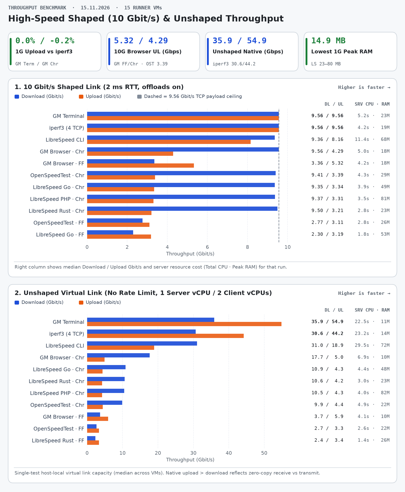
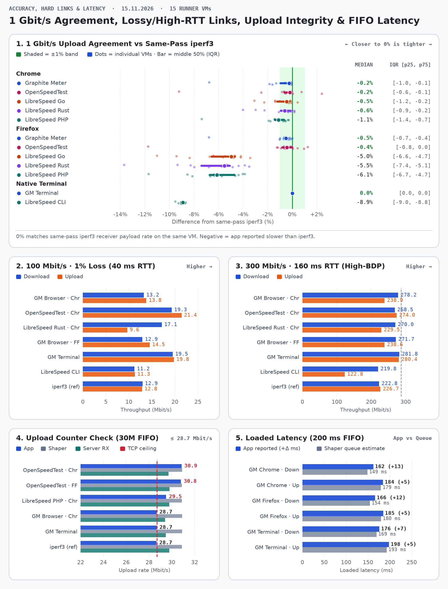
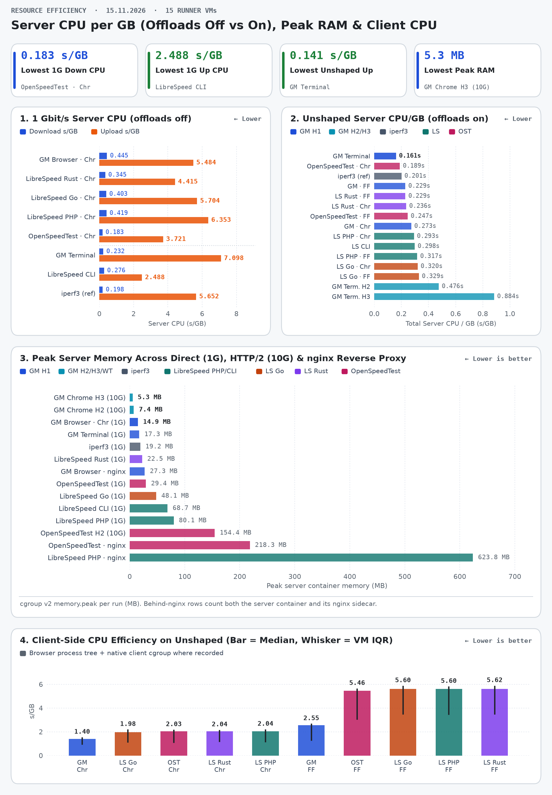
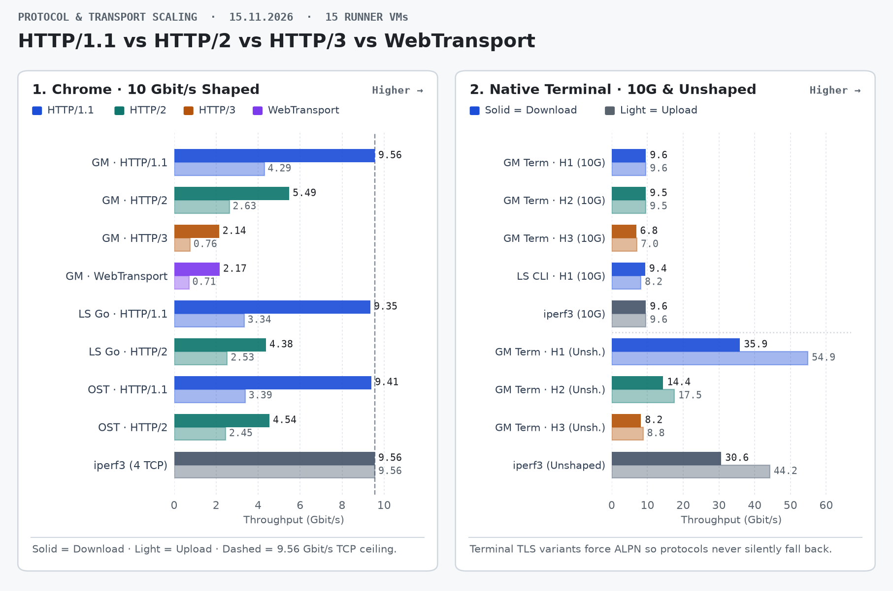
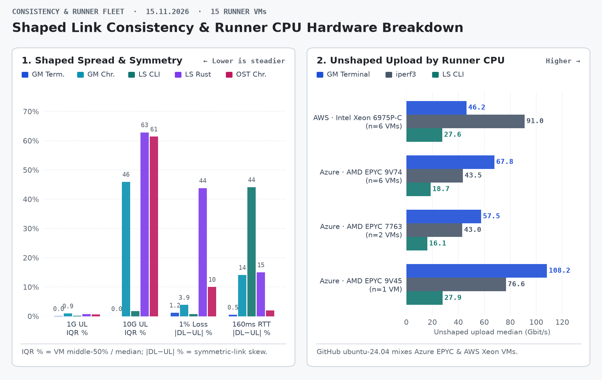

# Self-hosted speed test bench

A comparison of app-reported results for open-source, self-hosted speed tests on controlled virtual network paths.
Each server uses an upstream release. Pinned browsers and native terminal clients share the same paths and runner
resources as separate iperf3 reference runs.

**Conflict of interest:** this repository is maintained by the author of [Graphite Meter](https://github.com/zR-JB/graphite-meter),
one of the tools compared. The harness and adapters are public. Each hosted report links to its run for raw
measurements and generated configs while GitHub retains the artifacts. Corrections are welcome as issues.

[Throughput](#1-high-speed-throughput-10-gbits--unshaped) · [Accuracy & latency](#2-accuracy-hard-links--latency) ·
[Resources](#3-server--client-resource-efficiency) · [Transports](#4-protocol--transport-scaling) ·
[Consistency](#5-consistency--runner-hardware) · [Historic trends](#historic-trends) ·
[Method](#how-it-works) · [Desktop results](#results-desktop-night-of-18-to-19-october-2026) · [Run it](#run-it)

## Latest GitHub runner results

**15.11.2026** · **5,490/5,490** retained runs completed across **15 runner jobs** (0 runs excluded by the busy-host rule). The 25 and 40 Gbit/s shaped scenarios are skipped on these 4-vCPU runners. They require 8+ CPUs.

[Full report and tested versions](results/2026-11-15-ci-run-43720854999) · [Benchmark source](https://github.com/zR-JB/selfhosted-speedtest-bench/tree/dfc3d934b77f3ee96839225c1060fa53b1e71183) · [Workflow run and raw artifacts](https://github.com/zR-JB/selfhosted-speedtest-bench/actions/runs/43720854999) · [Previous report](results/2026-11-15-ci-run-43694138029)

**Browsers:** Chrome 157.0.8103.78 · Firefox 160.0  
**Tools:** Graphite Meter Browser 0.14.3 · Graphite Meter without loaded latency 0.14.3 · LibreSpeed 6.3.1 · LibreSpeed Go backend 1.1.6 · LibreSpeed Rust backend 1.4.0 · OpenSpeedTest 2.5.4 · Graphite Meter Terminal 0.14.3 · Graphite Meter Terminal without loaded latency 0.14.3 · LibreSpeed CLI 1.0.14 ([exact pins & full tables](results/2026-11-15-ci-run-43720854999/#tested-versions))

### 1. High-speed throughput (10 Gbit/s & Unshaped)

<picture>
  <source media="(prefers-color-scheme: dark)" srcset="results/2026-11-15-ci-run-43720854999/chart-throughput-dark.png">
  
</picture>

10 Gbit/s shaped links use 2 ms RTT with offloads on (`9.56 Gbit/s` TCP payload ceiling); unshaped runs remove rate limits on 4-vCPU runners (1 server / 2 client / 1 shaper).
[Shaped summary](results/2026-11-15-ci-run-43720854999/#shaped-throughput) · [10 Gbit/s spread](results/2026-11-15-ci-run-43720854999/#10-gbits-upload-spread) · [Unshaped tables](results/2026-11-15-ci-run-43720854999/#unshaped-throughput-and-browser-cpu)

### 2. Accuracy, hard links & latency

<picture>
  <source media="(prefers-color-scheme: dark)" srcset="results/2026-11-15-ci-run-43720854999/chart-accuracy-dark.png">
  
</picture>

On the FIFO path, OpenSpeedTest’s reported rate exceeded the matched iperf3 receiver rate in **30/30 Chrome** and **30/30 Firefox** passes. Tests ran sequentially. App and iperf3 start times were a median of 3.4 minutes apart (maximum 9.4).
[1 Gbit/s agreement](results/2026-11-15-ci-run-43720854999/#matched-1-gbits-agreement) · [Upload counter checks](results/2026-11-15-ci-run-43720854999/#upload-counter-checks) · [Idle & FIFO latency](results/2026-11-15-ci-run-43720854999/#idle-latency-against-icmp)

### 3. Server & client resource efficiency

<picture>
  <source media="(prefers-color-scheme: dark)" srcset="results/2026-11-15-ci-run-43720854999/chart-resources-dark.png">
  
</picture>

Server CPU is container CPU time per decimal GB of server-interface traffic during each phase, counting bytes in both directions. Peak memory is the container’s per-run peak in decimal MB. The adjacent reported rates show how much of the same shaped link each setup used. Browser CPU is measured separately on the client. Native client CPU was not yet collected in this run. Over the full Chrome test the median total server CPU time was **6.03 s** for OpenSpeedTest and **3.74 s** for Graphite Meter Browser. Total time reflects both the amount of data moved and the work per byte.
[Full resource tables](results/2026-11-15-ci-run-43720854999/#server-resources-at-1-gbits) · [All server CPU phases](results/2026-11-15-ci-run-43720854999/server-cpu.md) · [Without-loaded-latency delta](results/2026-11-15-ci-run-43720854999/#graphite-meter-without-loaded-latency)

### 4. Protocol & transport scaling

<picture>
  <source media="(prefers-color-scheme: dark)" srcset="results/2026-11-15-ci-run-43720854999/chart-transports-dark.png">
  
</picture>

All TLS variants use one self-signed certificate per job; terminal variants force ALPN so protocols never silently fall back.
[1 Gbit/s transports](results/2026-11-15-ci-run-43720854999/#11-gbits-20-ms-rtt-fq_codel) · [10 Gbit/s transports](results/2026-11-15-ci-run-43720854999/#1010-gbits-2-ms-rtt-fq_codel-offloads-on) · [Reverse proxy](results/2026-11-15-ci-run-43720854999/#11-gbits-20-ms-rtt-fq_codel-behind-nginx)

### 5. Consistency & runner hardware

<picture>
  <source media="(prefers-color-scheme: dark)" srcset="results/2026-11-15-ci-run-43720854999/chart-consistency-dark.png">
  
</picture>

Graphite Meter Terminal had a higher upload rate than iperf3 on **9 of 15 VMs** after matching passes. The split was 0/6 on AWS-kernel VMs, 9/9 on Azure-kernel VMs. [Hardware breakdown](results/2026-11-15-ci-run-43720854999/#unshaped-native-upload-by-runner-hardware) · [All pooled pass tables](results/2026-11-15-ci-run-43720854999/#pooled-pass-tables)

## What runs

| Tool | Deployment |
| --- | --- |
| Graphite Meter Browser | `ghcr.io/zr-jb/graphite-meter`, defaults |
| LibreSpeed | `ghcr.io/librespeed/speedtest` (`latest` image), defaults (classic page), overhead factor 1 |
| LibreSpeed Go backend | Release binary with its bundled `settings.toml` (no public image), serving its embedded page, overhead factor 1 |
| LibreSpeed Rust backend | `ghcr.io/librespeed/speedtest-rust`, defaults, overhead factor 1 |
| OpenSpeedTest | `openspeedtest/latest`, defaults (nginx, HTTP/1.1), `?clean` |
| Graphite Meter Terminal | Release binary, `--report`, against the Graphite Meter server |
| LibreSpeed CLI | Release binary, `--json`, against the LibreSpeed (PHP) server |

Tables compare against a modeled TCP payload ceiling on paths where iperf3 reaches it. Current versions, image digests,
browser builds and checksums are in
[`pins.json`](pins.json); each results section names the versions it ran, and each run's manifest records them exactly.

Transport variants, each set up only as its project documents, in Chrome in the 1, 10, 25 and 40 Gbit/s scenarios and at
0.1 % loss, and for Graphite Meter's terminal client in those scenarios and the unshaped one:

| Variant | Setup | Protocol evidence |
| --- | --- | --- |
| Graphite Meter, HTTP/2 / HTTP/3 / WebTransport | Native TLS listeners (`GM_H1_TLS_ADDR`, `GM_H2_ADDR`, `GM_H3_ADDR`), page over HTTPS, connection path set in its settings | The browser-observed protocol in each saved result |
| LibreSpeed Go backend, HTTP/2 | `enable_tls` and `enable_http2` in its `settings.toml` | The server's negotiated protocol, checked with curl before each run |
| OpenSpeedTest, HTTP/2 | `http2` on its TLS listener plus its documented upload fix, in its nginx config | The same curl check |
| Graphite Meter terminal client, HTTP/2 / HTTP/3 | The same native listeners; `--throughput-protocol`, `--throughput-transport fetch-stream` and `--latency-transport websocket`, as the browser variants set their connection path | The client offers only that protocol in its TLS handshake, so it cannot fall back |

All TLS uses one self-signed certificate per job; Chrome trusts its key by hash and the terminal client takes it with
its documented `--insecure`. Firefox is left out of these cells: it does not accept a test certificate for QUIC, and
Graphite Meter's own tests keep its HTTP/2 cells Chrome-only for a Firefox worker bug. LibreSpeed's PHP image and Rust
backend document no HTTP/2 setting and are not in this profile.

### Default test settings

The headline comparison uses the applications as configured below. Transfer stages use HTTP/1.1 on the plain test
path. The connection counts are configured settings. The harness does not count active connections in each run.

| Client | Download / upload concurrency | Duration per direction | Latency during transfers | Display compensation |
| --- | --- | --- | --- | --- |
| Graphite Meter Browser | Adaptive | 10 s target | Enabled | Payload rate |
| LibreSpeed PHP, Go and Rust browsers | 5 / 3 in Chrome, 6 / 3 in Firefox in the bundled worker defaults | Up to 15 s, with adaptive timing | Idle only | Set to 1.00 |
| OpenSpeedTest | 6 / 6 configured | 12 s configured | Idle only | `?clean` sets 1.00 |
| Graphite Meter Terminal | Auto, 6 / 6 on the default HTTP/1.1 path | 10 s target | Enabled | Payload rate |
| LibreSpeed CLI | 3 concurrent HTTP requests | 15 s | Idle only | Payload rate |

Graphite Meter runs latency probes during throughput by default. The browser and terminal profiles without loaded latency
use the same server release, automatic stream and transport settings, and transfer durations as their defaults. Both profiles
skip the app’s idle-latency stage and its loaded probes. The terminal profile adds `--stages download,upload`, which uses
the default `--skip-loaded-latency` behavior. The harness still measures idle path RTT independently. The separate transport
variants use the documented settings above. The LibreSpeed web worker’s display factor defaults to 1.06, and
the OpenSpeedTest page defaults to 1.04. The harness uses each application's adjustment for payload-rate display.

[Graphite Meter browser defaults](https://github.com/zR-JB/graphite-meter/blob/v0.14.4/client/src/app/preferences.ts) ·
[Graphite Meter terminal flags](https://github.com/zR-JB/graphite-meter/blob/v0.14.4/docs/TERMINAL.md#flags) ·
[LibreSpeed web worker](https://github.com/librespeed/speedtest/blob/v6.3.1/speedtest_worker.js) ·
[LibreSpeed CLI flags](https://github.com/librespeed/speedtest-cli/blob/v1.0.15/main.go) ·
[OpenSpeedTest defaults](https://github.com/openspeedtest/Speed-Test/blob/f4263546f50694a154fdd27a03000390949068df/index.html)

Browsers: Chrome for Testing and Firefox release builds, fresh profile per run, headed under Xvfb.

## How it works

```
 client container            shaper container                server container
 (browser, iperf3)  <-veth->  tc: netem + tbf  <-veth->  (one tool, fresh each run)
   10.71.1.10        cl: shapes downloads | sv: shapes uploads      10.71.2.10
```

- One Linux host; each role has its own network namespace, joined by direct veth pairs with a 1,500 byte MTU.
  Containers start with `--network none` and the harness wires them; no container bridge, port publishing or NAT is in
  the path. The same network setup applies to every tool.
- The shaper applies half the RTT on each side (`netem`), the rate (`tbf`), and the queue: a FIFO of fixed depth, or
  `fq_codel`. Segmentation offloads are off up to 1 Gbit/s and wherever loss applies, so shaping and loss act on real
  frames; the 10, 25 and 40 Gbit/s and unshaped scenarios turn them on, as real network cards do.
- CPU sets and memory caps are fixed per role (shaper, server, client) and the same for every tool.
- Every runner job tests every eligible tool and browser and an iperf3 reference on the same VM. The first pass visits every scenario. The next pass reverses the tool order within each scenario.
  Each VM uses a separate seed. The overview takes a median per VM before summarizing across VMs. The full scenario
  tables pool retained passes. Both leave out a whole pass when its pre-pass or post-pass CPU probe takes more than 125% of that
  VM’s median, when hypervisor CPU steal exceeds 5% during the pass, or when the pass’s iperf3 control collapses below 75% of the modeled ceiling on a clean shaped link.
- The iperf3 reference records receiver payload with four parallel TCP streams and a 10-second measured window,
  after omitting the first two seconds. The tools image installs the distro’s iperf3 and traffic-control packages.
  The historical manifests record the runner image and kernel. They do not record the exact versions of those packages.
- Each tool is pressed through its own start button; results are read from what the page shows or saves. Adapters are
  in [`bench/driver/adapters`](bench/driver/adapters). Graphite Meter Browser’s adapter reads the saved measurement at
  full precision. The other browser adapters read the rounded display values. Terminal clients run in the client's
  namespace and their own report is parsed.
- The proxy scenario puts the same nginx in front of every tool whose project documents a proxy setup, with only the
  directives that project's documentation asks for (recorded in `pins.json`). iperf3 bypasses nginx and measures the
  direct shaped path as a control.
- The competing-traffic scenario adds one bulk TCP flow each way through the same bottleneck for the whole run.
- The two-server scenario gives each server its own 200 Mbit/s path. Only tools that measure several servers at once
  run in it (Graphite Meter, through its documented server catalogue); the others test one server at a time.
- After every run the harness checks that nothing was left behind (browser processes, helper containers, sampler
  loops) and stops the job otherwise; three harness errors in a row also stop it. A full bench only starts after a
  [smoke](.github/workflows/smoke.yml) passes with no harness error. It runs every eligible tool and client on the
  1 Gbit/s path, including both pinned browsers where supported. Graphite Meter in Chrome and the iperf3 control
  also exercise the FIFO queue, packet loss, competing traffic, nginx proxy, two-server setup, and unshaped path.
- Bench verifies the committed pins against the current stable releases before starting smoke tests. The
  [release watcher](.github/workflows/watch.yml) checks every Monday at 04:00 UTC and can also run on demand.
  It proposes pin updates in a pull request. Pin-only pushes run smoke through Bench. The regular benchmark
  runs on the first of each month at 03:00 UTC. The [report workflow](.github/workflows/publish-report.yml) publishes
  updated tables and charts after each successful full run.

## What is compared

| Measure | Reference |
| --- | --- |
| Download and upload | Modeled TCP payload ceiling of 1,448 bytes per 1,514-byte Ethernet frame, with IPv4 and TCP timestamps. Used where iperf3 reaches the modeled rate. |
| Download and upload with loss, a long path or competing traffic | Compare achieved rates with the other tools and iperf3 in the same scenario. Loss, delay and competing traffic can limit throughput below the configured rate. Under competition, the raw data also record each run’s median share measured on the shaper. |
| Idle latency | Minimum of ten ICMP pings, 200 ms apart, on the same shaped path before each pass. App readings can include browser timing limits and server handling. |
| Latency under load | Idle ICMP baseline plus the FIFO queue delay sampled every 100 ms during the transfer. This is an estimate of path RTT. The benchmark has no equivalent loaded reference under `fq_codel`. |
| Independent transfer rate | Passive server interface byte counter over sustained intervals for each direction. It includes transport overhead and is separate from the app’s own reporting window. Skipped for competing traffic, where another flow shares that interface. |
| Server CPU and memory | The server container's cgroup: CPU seconds per GB moved, peak memory; each run also splits that CPU by 100 ms samples into download, upload and other phases, which `bench/phases.js` tables |
| Client CPU (browser & native) | CPU seconds per GB moved: browser process-tree CPU for browser runs, and container cgroup v2 CPU + peak memory for native terminal clients and iperf3 (recorded on campaigns from November 2026 onward). |

Scenarios are in [`scenarios.json`](scenarios.json): 100 Mbit/s and 1 Gbit/s at 20 ms RTT; 10, 25 and 40 Gbit/s at
2 ms (25 and 40 only on hosts with at least 8 CPUs); 300/30 Mbit/s behind a 200 ms FIFO; 1 % and 0.1 % loss at 40 ms;
a 160 ms path; competing traffic; a reverse proxy; two servers; and an unshaped run. This testbed cannot show real
network card, Wi-Fi or switch behaviour, and the unshaped scenario measures observed throughput on its host-local virtual network.
(Earlier single-pass receiver-counter smoke validation: [`results/2026-11-14-upload-counter-smoke.json`](results/2026-11-14-upload-counter-smoke.json).)

## Results: desktop, night of 18 to 19 October 2026

A second dataset from an AMD Ryzen 7 7800X3D desktop (8 cores, 16 threads, kernel 7.2.10-1-cachyos, rootless Podman),
with the browser on three cores instead of the runners' two vCPUs, the same tools and versions as the 18 October
runner run (Graphite Meter 0.13.1, Chrome 155, Firefox 158.0), and the 25 and 40 Gbit/s scenarios: 6 runs per tool,
browser and scenario, 1,074 runs, all complete. Full tables and setup:
[`results/2026-10-18-desktop-7800x3d`](results/2026-10-18-desktop-7800x3d). The detailed tables show the spread of those six runs per setup.

At 1% loss, iperf3 reached 94 Mbit/s on the desktop and about 13 Mbit/s on the runners. The testbeds differed in
hardware, kernel, and runtime. Compare the loss, long-path, and deep-buffer results within each dataset.

- **10 Gbit/s with three browser cores:** over HTTP/1.1, Chrome reaches the link in both directions with every tool
  (9.55 to 9.60 Gbit/s). In Firefox, Graphite Meter downloads at 9.60 Gbit/s and uploads at 7.8; the LibreSpeed
  backends reach 8.4 to 9.2 down and 8.2 to 8.5 up; OpenSpeedTest 7.1 down and 9.5 up.
- **25 Gbit/s:** Graphite Meter's client fills the link (23.91 Gbit/s both ways; iperf3 23.90 and 23.45). Chrome
  downloads reach it with every tool; Chrome uploads stop at 12.9 Gbit/s with Graphite Meter and 11.1 to 11.4 with the
  others. In Firefox, Graphite Meter reaches 17.7 Gbit/s down and the others 8.3 to 10.4.
- **40 Gbit/s:** only Graphite Meter's client fills the link (38.26 Gbit/s both ways; iperf3 37.8 and 37.5). In
  Chrome, Graphite Meter downloads at 33.6 Gbit/s and the others at 24.2 to 24.7; uploads stop at 12.7 and 11.1 to
  11.3.
- **Unshaped:** Chrome downloads reach 39.0 Gbit/s with Graphite Meter and 24.1 to 24.5 with the others, uploads 15.1
  and 13.9 to 14.1. Graphite Meter's client moves 185 Gbit/s down and 242 up, iperf3 172 and 207. Server CPU per GB:
  0.11 to 0.14 s for Graphite Meter, OpenSpeedTest and the Rust backend, 0.15 to 0.18 s for LibreSpeed's Go and PHP
  backends.
- **Upload on plain links.** Graphite Meter 0.13.1’s Firefox upload at 1 Gbit/s was 3.2% below the modeled TCP
  payload ceiling on the desktop and 11.1% below on the 18 October runners. OpenSpeedTest reported 1.7–4.5% above
  the model at 100 Mbit/s and 2.0–2.6% above at 1 Gbit/s on the desktop.
- **Behind a 200 ms FIFO.** Graphite Meter’s reported upload was within 0.3% of the modeled ceiling and its loaded
  latency was within 6 ms of the queue estimate. OpenSpeedTest reported 7.0% above the ceiling in Chrome and 27% above
  in Firefox.
- **Behind nginx.** Reported upload was below the modeled ceiling by 10.0% in Chrome and 11.6% in Firefox for
  OpenSpeedTest, 3.6% and 10.6% for LibreSpeed, and 2.2% and 1.6% for Graphite Meter.

## Run it

Needs Linux with cgroup v2, Podman, Node 22 or later, `nsenter`, `ethtool`, `curl`, `unzip` and `xz`. Rootless Podman
works; set `SB_ROOTFUL=1` to use `sudo podman` instead. Several instances can share a machine: `SB_PREFIX` names their
containers and `SB_CPUSETS` (for example `{"shaper":"6","server":"14","client":"7,15"}`) gives each its own cores.
`SB_PIN_OVERRIDES` swaps pins for a local experiment, such as a locally built image (`localhost/...`) of a fix branch;
the run's manifest records what ran.

```sh
node bench/run.js --scenarios accuracy-100 --reps 1
node bench/summarize.js results/local-*
node bench/phases.js results/local-*
```

Published numbers come from the [Bench workflow](.github/workflows/bench.yml) on GitHub-hosted runners, where every
log is public, and from full campaigns on a named local machine, whose raw data and manifests are committed the same
way. Shorter local runs are for development.

<!-- historic-trends-start -->
## Historic trends

Automatically updated after every full 15-job GitHub runner campaign (**7 runs** from **18.10.2026** to **15.11.2026**). Points show per-VM medians across each campaign; shaded bands show the middle 50% (IQR) across runner VMs; dotted vertical lines mark Graphite Meter release transitions.

<picture>
  <source media="(prefers-color-scheme: dark)" srcset="results/history-trends-dark.png">
  
</picture>
<!-- historic-trends-end -->
