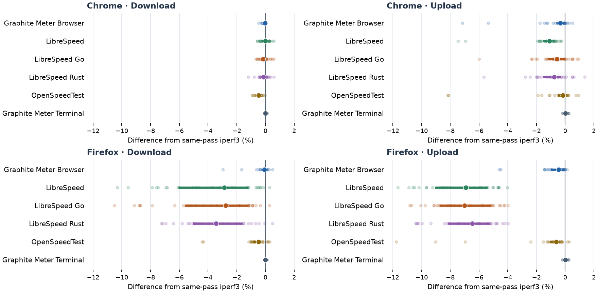
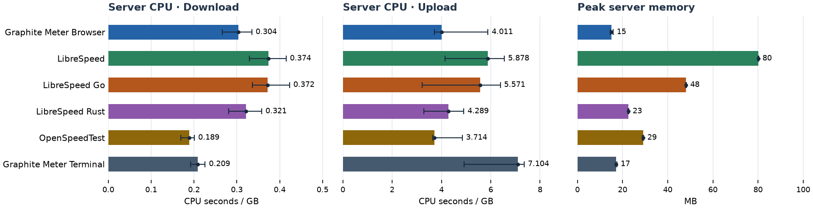
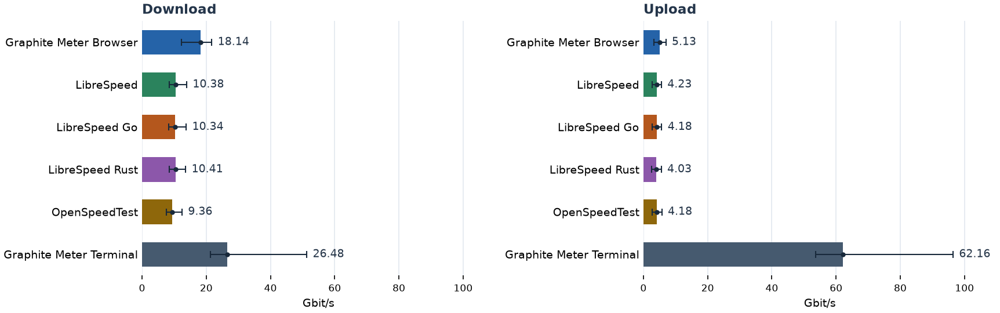

# Self-hosted speed test bench

A reproducible comparison of open-source, self-hosted speed test applications: each one deployed from its authors'
own image, driven through its own page in pinned browsers, over the same shaped network paths, and checked against a
reference that does not come from any of the tools.

**Conflict of interest:** this repository is maintained by the author of [Graphite Meter](https://github.com/zR-JB/graphite-meter),
one of the tools compared. The harness and adapters are public. Each hosted report links to its run for raw
measurements and generated configs while GitHub retains the artifacts. Corrections are welcome as issues.

[Latest runner report](#latest-github-runner-results) · [Server load](#server-load-at-1-gbits) · [Terminal performance](#terminal-performance) ·
[Uncapped throughput](#uncapped-throughput) · [Method](#how-it-works) ·
[Desktop results](#results-desktop-night-of-18-to-19-october-2026) · [Run it](#run-it)

## Latest GitHub runner results

**1 November 2026** · **4,530/4,530** scored runs completed · **15** independent runner jobs · **0** runs excluded by the busy-host rule

Tools: Graphite Meter 0.13.4, LibreSpeed 6.3.1, LibreSpeed Go backend 1.1.6, LibreSpeed Rust backend 1.4.0, OpenSpeedTest 2.5.4, Graphite Meter terminal client 0.13.4, LibreSpeed CLI 1.0.14. Browsers: chrome 156.0.8078.47, firefox 158.0.1.

### Shaped throughput

Download / upload medians for default Chrome and native terminal tests. **Graphite Meter Browser**
uses streaming HTTP/1.1. The 1 Gbit/s path tests reporting accuracy. The 10 Gbit/s and 1% packet-loss paths show
how much traffic each tool moved under those conditions. Connection counts can differ between tools.

| Tool or client | 1 Gbit/s link, Mbit/s | 10 Gbit/s link, Gbit/s | 100 Mbit/s with 1% loss, Mbit/s |
| --- | ---: | ---: | ---: |
| Graphite Meter Browser | 956.1 / 952.7 | 9.56 / 4.26 | 13.2 / 14.1 |
| LibreSpeed | 956.5 / 944.5 | 9.27 / 3.27 | 16.8 / 9.7 |
| LibreSpeed Go backend | 955.0 / 950.5 | 9.33 / 3.24 | 16.6 / 9.6 |
| LibreSpeed Rust backend | 955.0 / 948.5 | 9.28 / 3.24 | 16.6 / 9.4 |
| OpenSpeedTest | 952.0 / 953.8 | 9.46 / 3.38 | 19.3 / 22.4 |
| Graphite Meter Terminal | 956.4 / 956.4 | 9.56 / 9.56 | 19.7 / 19.6 |
| iperf3 (reference) | 956.4 / 956.3 | 9.56 / 9.56 | 12.9 / 13.1 |

#### Accuracy on the shaped 1 Gbit/s link



Each faint dot is one tool run paired with iperf3 on the same VM, scenario, and pass. The large dot is the median
paired difference. The line spans the 25th to 75th percentile. Zero matches iperf3. Positive values mean the tool
displayed a higher rate. Each VM contributes two passes. Both browser rows show the same native terminal runs for comparison.

### Compare for your setup

- **Ordinary links.** The 1 Gbit/s accuracy chart shows how close each browser test got to its paired reference.
- **High-throughput links.** Compare the shaped 10 Gbit/s numbers first, then use the uncapped results to see how each
  client performed on these VMs.
- **Resource-limited servers.** Compare peak memory and upload CPU at 1 Gbit/s. The testbed gives every server one vCPU.

### Terminal performance

Graphite Meter Terminal uses the native client. The charts show its results alongside the five browser tools, and
the uncapped table also includes LibreSpeed CLI and iperf3. Server CPU refers to the server container. The full
uncapped tables report browser CPU separately. Native client CPU is unmeasured.

### Server load at 1 Gbit/s

The browser and terminal tests use the same shaped link. CPU seconds per GB measure server container work per GB counted
on its interface during each phase. Memory is the median of each run’s peak container memory.



Bars show medians. Whiskers show the middle half of observed runs. Each metric uses its own scale.

| Tool or client | Download / upload, Mbit/s | Server download CPU, s/GB | Server upload CPU, s/GB | Peak server memory, MB |
| --- | ---: | ---: | ---: | ---: |
| Graphite Meter Browser | 956.1 / 952.7 | 0.304 | 4.011 | 15 |
| LibreSpeed | 956.5 / 944.5 | 0.374 | 5.878 | 80 |
| LibreSpeed Go backend | 955.0 / 950.5 | 0.372 | 5.571 | 48 |
| LibreSpeed Rust backend | 955.0 / 948.5 | 0.321 | 4.289 | 23 |
| OpenSpeedTest | 952.0 / 953.8 | 0.189 | 3.714 | 29 |
| Graphite Meter Terminal | 956.4 / 956.4 | 0.209 | 7.104 | 17 |

### Uncapped throughput

The unshaped scenario removes the rate limit and artificial delay and keeps offloads enabled. These are median
single-test rates over the runner’s virtual network. The server has one vCPU and the browser has two. The browser,
server, and runner can each cap the result. A capacity test for a production server would also need separate client
machines and concurrent tests. **Graphite Meter Terminal** runs `graphite-meter-client --url http://10.71.2.10:7246
--report`. The default path uses streaming HTTP/1.1 with six lanes in each direction, 10-second download and upload
windows, and loaded latency enabled. The full tables include the separately measured transport variants.



Bars show the median. Whiskers span the 25th to 75th percentile of repeated runs for the same setup.
The browser rows use default Chrome settings. The terminal row uses the native client.

| Browser tool | Chrome down / up, Gbit/s | Firefox down / up, Gbit/s | Chrome server CPU, s/GB | Chrome server peak, MB |
| --- | ---: | ---: | ---: | ---: |
| Graphite Meter Browser | 18.14 / 5.13 | 3.86 / 6.25 | 0.27 | 8 |
| LibreSpeed | 10.38 / 4.23 | 2.28 / 3.37 | 0.30 | 81 |
| LibreSpeed Go backend | 10.34 / 4.18 | 2.29 / 3.30 | 0.32 | 49 |
| LibreSpeed Rust backend | 10.41 / 4.03 | 2.22 / 3.40 | 0.24 | 22 |
| OpenSpeedTest | 9.36 / 4.18 | 2.67 / 3.25 | 0.19 | 21 |

| Native client | Down / up, Gbit/s | Server CPU, s/GB | Server peak, MB |
| --- | ---: | ---: | ---: |
| Graphite Meter Terminal | 26.48 / 62.16 | 0.19 | 9 |
| LibreSpeed CLI | 28.26 / 18.54 | 0.33 | 71 |
| iperf3 (reference) | 31.01 / 44.10 | 0.20 | 12 |

Graphite Meter Terminal uploaded faster than it downloaded in **28 of 30** uncapped tests.
iperf3 did so in **30 of 30**. The server used a median **0.301 CPU s/GB** while
sending and **0.126 CPU s/GB** while receiving for Graphite Meter Terminal. The terminal counts
download bytes and time at the client and upload bytes and time at the server.

[Download and upload CPU breakdown for all scenarios and transports](results/2026-11-01-ci-run-41295946781/server-cpu.md)

### Independent upload check

The 1 Gbit/s OpenSpeedTest results below use the tool’s displayed payload rate and independent network counters.
The shaper measures a median over busy intervals and includes protocol overhead. The server-interface rate, when
available, averages bytes received during sustained upload intervals. Neither uses the app’s timing window, so their
difference from the displayed rate is a diagnostic rather than an exact payload error.

| Browser | Displayed upload, Mbit/s | Shaper busy median, Mbit/s | Server interface, Mbit/s | Above paired iperf3 |
| --- | ---: | ---: | ---: | ---: |
| Chrome | 953.8 | 970.3 | — | 9/30 |
| Firefox | 950.0 | 965.8 | — | 2/30 |

### Latency and alternate transports

- **Latency under load.** On the 200 ms FIFO, Graphite Meter in Chrome measured **180.3 (171.2) ms**
  during download and **182.9 (180.0) ms** during upload, with the queue-based reference in
  parentheses. See the full tables for which tools reported loaded latency.
- **HTTP/3 and WebTransport.** Use the transport-specific rows if you plan to deploy them. On the 1 Gbit/s link,
  Graphite Meter in Chrome reported **139.9 Mbit/s upload over HTTP/3**
  and **668.5 Mbit/s over WebTransport**.

[Full tables and run details](results/2026-11-01-ci-run-41295946781) ·
[Hosted run, raw measurements and screenshots](https://github.com/zR-JB/selfhosted-speedtest-bench/actions/runs/41295946781) ·
[Previous report, 22 October 2026](results/2026-10-22-ci-run-39772524145)

## What runs

| Tool | Deployment |
| --- | --- |
| Graphite Meter | `ghcr.io/zr-jb/graphite-meter`, defaults |
| LibreSpeed | `ghcr.io/librespeed/speedtest` (`latest` image), defaults (classic page), overhead factor 1 |
| LibreSpeed Go backend | Release binary with its bundled `settings.toml` (no public image), serving its embedded page, overhead factor 1 |
| LibreSpeed Rust backend | `ghcr.io/librespeed/speedtest-rust`, defaults, overhead factor 1 |
| OpenSpeedTest | `openspeedtest/latest`, defaults (nginx, HTTP/1.1), `?clean` |
| Graphite Meter terminal client | Release binary, `--report`, against the Graphite Meter server |
| LibreSpeed CLI | Release binary, `--json`, against the LibreSpeed (PHP) server |

Every tool is scored against the payload rate. Current versions, image digests, browser builds and checksums are in
[`pins.json`](pins.json); each results section names the versions it ran, and each run's manifest records them exactly.

Transport variants, each set up only as its project documents, in Chrome in the 1, 10, 25 and 40 Gbit/s scenarios and at
0.1 % loss, and for Graphite Meter's terminal client in those scenarios and the unshaped one:

| Variant | Setup | Protocol evidence |
| --- | --- | --- |
| Graphite Meter, HTTP/2 / HTTP/3 / WebTransport | Native TLS listeners (`GM_H1_TLS_ADDR`, `GM_H2_ADDR`, `GM_H3_ADDR`), page over HTTPS, connection path set in its settings | The browser-observed protocol in each saved result |
| LibreSpeed Go backend, HTTP/2 | `enable_tls` and `enable_http2` in its `settings.toml` | The server's negotiated protocol, checked with curl before each run |
| OpenSpeedTest, HTTP/2 | `http2` on its TLS listener plus its documented upload fix, in its nginx config | The same curl check |
| Graphite Meter terminal client, HTTP/2 / HTTP/3 | The same native listeners; `--throughput-protocol`, `--throughput-transport fetch-stream` and `--latency-transport websocket`, as the browser variants set their connection path | The client offers only that protocol in its TLS handshake, so it cannot fall back |

All TLS uses one self-signed certificate per job; Chrome trusts its key by hash and the terminal client takes it with
its documented `--insecure`. Firefox is left out of these cells: it does not accept a test certificate for QUIC, and
Graphite Meter's own tests keep its HTTP/2 cells Chrome-only for a Firefox worker bug. LibreSpeed's PHP image and Rust
backend document no HTTP/2 setting and are not in this profile.

By default LibreSpeed shows its measured rate × 1.06 and OpenSpeedTest × 1.04, as an estimate of transport overhead.
In both, the factor only multiplies the displayed rate: test duration, stop rules and stream counts use the
unadjusted rate (`speedtest_worker.js` lines 404 to 411 and 562 to 569; `app-2.5.4.js` `upAdjust`, whose only consumer
is the displayed and averaged rate). So the bench turns it off with each project's documented setting
(`setParameter("overheadCompensationFactor", 1)` and the `?clean` URL parameter) and scores every tool against the
same payload rate. A default page shows exactly these numbers × 1.06 or × 1.04.

Browsers: Chrome for Testing and Firefox release builds, fresh profile per run, headed under Xvfb.

## How it works

```
 client container            shaper container                server container
 (browser, iperf3)  <-veth->  tc: netem + tbf  <-veth->  (one tool, fresh each run)
   10.71.1.10        cl: shapes downloads | sv: shapes uploads      10.71.2.10
```

- One Linux host; each role has its own network namespace, joined by direct veth pairs with a 1,500 byte MTU.
  Containers start with `--network none` and the harness wires them; no container bridge, port publishing or NAT is in
  the path. This is the one difference from the
  authors' quick starts, and it applies to every tool alike.
- The shaper applies half the RTT on each side (`netem`), the rate (`tbf`), and the queue: a FIFO of fixed depth, or
  `fq_codel`. Segmentation offloads are off up to 1 Gbit/s and wherever loss applies, so shaping and loss act on real
  frames; the 10, 25 and 40 Gbit/s and unshaped scenarios turn them on, as real network cards do.
- CPU sets and memory caps are fixed per role (shaper, server, client) and the same for every tool.
- Every runner job tests every eligible tool and browser and an iperf3 reference on the same VM. The first pass visits
  every scenario, then the second pass repeats each scenario with its tool order reversed. Each VM has its own random
  seed, so no tool consistently goes first or last. The summary pools measured runs from the VMs and leaves out an
  entire scenario repetition when its CPU probe takes over 25% longer than that VM’s median. Small differences can
  still reflect runner variation.
- Each tool is pressed through its own start button; results are read from what the page shows or saves. Adapters are
  in [`bench/driver/adapters`](bench/driver/adapters), one small file per tool. Terminal clients run in the client's
  namespace and their own report is parsed.
- The proxy scenario puts the same nginx in front of every tool whose project documents a proxy setup, with only the
  directives that project's documentation asks for (recorded in `pins.json`).
- The competing-traffic scenario adds one bulk TCP flow each way through the same bottleneck for the whole run.
- The two-server scenario gives each server its own 200 Mbit/s path. Only tools that measure several servers at once
  run in it (Graphite Meter, through its documented server catalogue); the others test one server at a time.
- After every run the harness checks that nothing was left behind (browser processes, helper containers, sampler
  loops) and stops the job otherwise; three harness errors in a row also stop it. A full bench only starts after a
  [smoke](.github/workflows/smoke.yml) of every tool and every scenario passes with no harness error.
- Bench verifies the committed pins against the current stable releases before starting smoke tests. The
  [release watcher](.github/workflows/watch.yml) checks every Monday at 04:00 UTC and can also run on demand.
  It proposes pin updates in a pull request. Merging a pin update starts a new Bench run. The regular benchmark
  runs on the first of each month at 03:00 UTC. The [report workflow](.github/workflows/publish-report.yml) publishes
  updated tables and charts after each successful full run.

## What is compared

| Measure | Reference |
| --- | --- |
| Download and upload | Payload rate: 1,448 of every 1,514 bytes on the wire, where iperf3 shows the link can be filled |
| Download and upload with loss, a long path or competing traffic | None: TCP cannot fill these links, and a tool's share of a shared link grows over its run. The tools are compared with each other and with iperf3; each run's median share under competition, measured on the shaper, is in the raw data |
| Idle latency | Base RTT measured with ping before each block |
| Latency under load | Base RTT plus the bottleneck FIFO's queue delay, sampled on the shaper every 100 ms (FIFO scenarios only; under `fq_codel` a probe flow skips the bulk queue) |
| Independent transfer rate | Passive server interface byte counter over sustained intervals for each direction. It includes transport overhead and is separate from the app’s own reporting window. Skipped for competing traffic, where another flow shares that interface. |
| Server CPU and memory | The server container's cgroup: CPU seconds per GB moved, peak memory; each run also splits that CPU by 100 ms samples into download, upload and other phases, which `bench/phases.js` tables |
| Browser CPU (client side) | CPU seconds per GB of the browser's process tree, reported in the full uncapped tables. Native client CPU is not collected. |

Scenarios are in [`scenarios.json`](scenarios.json): 100 Mbit/s and 1 Gbit/s at 20 ms RTT; 10, 25 and 40 Gbit/s at
2 ms (25 and 40 only on hosts with at least 8 CPUs); 300/30 Mbit/s behind a 200 ms FIFO; 1 % and 0.1 % loss at 40 ms;
a 160 ms path; competing traffic; a reverse proxy; two servers; and an unshaped run. This testbed cannot show real
network card, Wi-Fi or switch behaviour, and its unshaped scenario shows where each tool runs out of CPU, not a
network's capacity.

## Results: desktop, night of 18 to 19 October 2026

A second dataset from an AMD Ryzen 7 7800X3D desktop (8 cores, 16 threads, kernel 7.2.10-1-cachyos, rootless Podman),
with the browser on three cores instead of the runners' two vCPUs, the same tools and versions as the 18 October
runner run (Graphite Meter 0.13.1, Chrome 155, Firefox 158.0), and the 25 and 40 Gbit/s scenarios: 6 runs per tool,
browser and scenario, 1,074 runs, all complete. Full tables and setup:
[`results/2026-10-18-desktop-7800x3d`](results/2026-10-18-desktop-7800x3d). With 6 runs per cell, differences of
about 2 % or less are within its noise.

This kernel's TCP recovers from random loss far better than the runners' (iperf3 reaches 94 Mbit/s at 1 % loss here
and 13 there, with the same netem loss and CUBIC on both), so its loss, long-path and deep-buffer numbers compare only
within that dataset.

- **10 Gbit/s with three browser cores:** over HTTP/1.1, Chrome reaches the link in both directions with every tool
  (9.55 to 9.60 Gbit/s). In Firefox, Graphite Meter downloads at 9.60 Gbit/s and uploads at 7.8; the LibreSpeed
  backends reach 8.4 to 9.2 down and 8.2 to 8.5 up; OpenSpeedTest 7.1 down and 9.5 up.
- **25 Gbit/s:** Graphite Meter's client fills the link (23.91 Gbit/s both ways; iperf3 23.90 and 23.45). Chrome
  downloads reach it with every tool; Chrome uploads stop at 12.9 Gbit/s with Graphite Meter and 11.1 to 11.4 with the
  others. In Firefox, Graphite Meter reaches 17.7 Gbit/s down and the others 8.3 to 10.4.
- **40 Gbit/s:** only Graphite Meter's client fills the link (38.26 Gbit/s both ways; iperf3 37.8 and 37.5). In
  Chrome, Graphite Meter downloads at 33.6 Gbit/s and the others at 24.2 to 24.7; uploads stop at 12.7 and 11.1 to
  11.3.
- **Unshaped:** Chrome downloads reach 39.0 Gbit/s with Graphite Meter and 24.1 to 24.5 with the others, uploads 15.1
  and 13.9 to 14.1. Graphite Meter's client moves 185 Gbit/s down and 242 up, iperf3 172 and 207. Server CPU per GB:
  0.11 to 0.14 s for Graphite Meter, OpenSpeedTest and the Rust backend, 0.15 to 0.18 s for LibreSpeed's Go and PHP
  backends.
- **Upload on plain links:** Graphite Meter 0.13.1's Firefox upload at 1 Gbit/s reads 3.2 % low here against 11.1 % on
  the 18 October runners, so that gap depended strongly on the host. OpenSpeedTest's upload reads above the payload
  rate here: 1.7 to 4.5 % at 100 Mbit/s and 2.0 to 2.6 % at 1 Gbit/s.
- **Behind a 200 ms FIFO:** Graphite Meter's upload again reads within 0.3 %, and its loaded latency lands within 6 ms
  of the queue reference. OpenSpeedTest's upload reads 7.0 % (Chrome) and 27 % (Firefox) above the payload rate.
- **Behind nginx:** OpenSpeedTest's upload reads 10.0 % (Chrome) and 11.6 % (Firefox) low, LibreSpeed's 3.6 % and 10.6
  %, Graphite Meter's 2.2 % and 1.6 %.

## Run it

Needs Linux with cgroup v2, Podman, Node 22 or later, `nsenter`, `ethtool`, `curl`, `unzip` and `xz`. Rootless Podman
works; set `SB_ROOTFUL=1` to use `sudo podman` instead. Several instances can share a machine: `SB_PREFIX` names their
containers and `SB_CPUSETS` (for example `{"shaper":"6","server":"14","client":"7,15"}`) gives each its own cores.
`SB_PIN_OVERRIDES` swaps pins for a local experiment, such as a locally built image (`localhost/...`) of a fix branch;
the run's manifest records what ran.

```sh
node bench/run.js --scenarios accuracy-100 --reps 1
node bench/summarize.js results/local-*
node bench/phases.js results/local-*
```

Published numbers come from the [Bench workflow](.github/workflows/bench.yml) on GitHub-hosted runners, where every
log is public, and from full campaigns on a named local machine, whose raw data and manifests are committed the same
way. Shorter local runs are for development.
