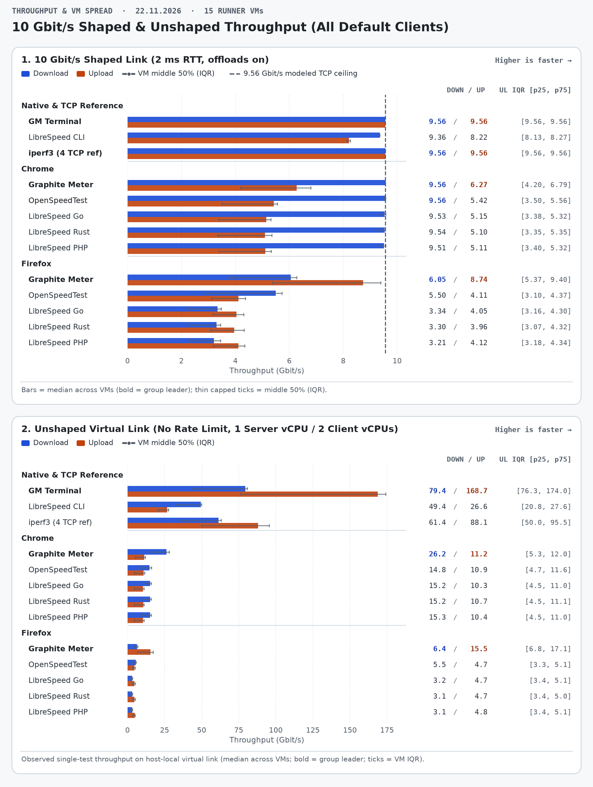
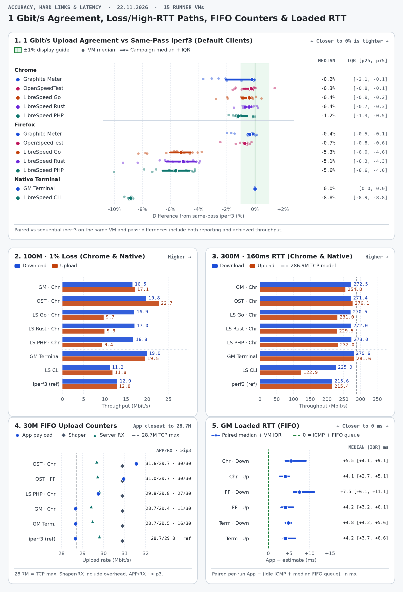
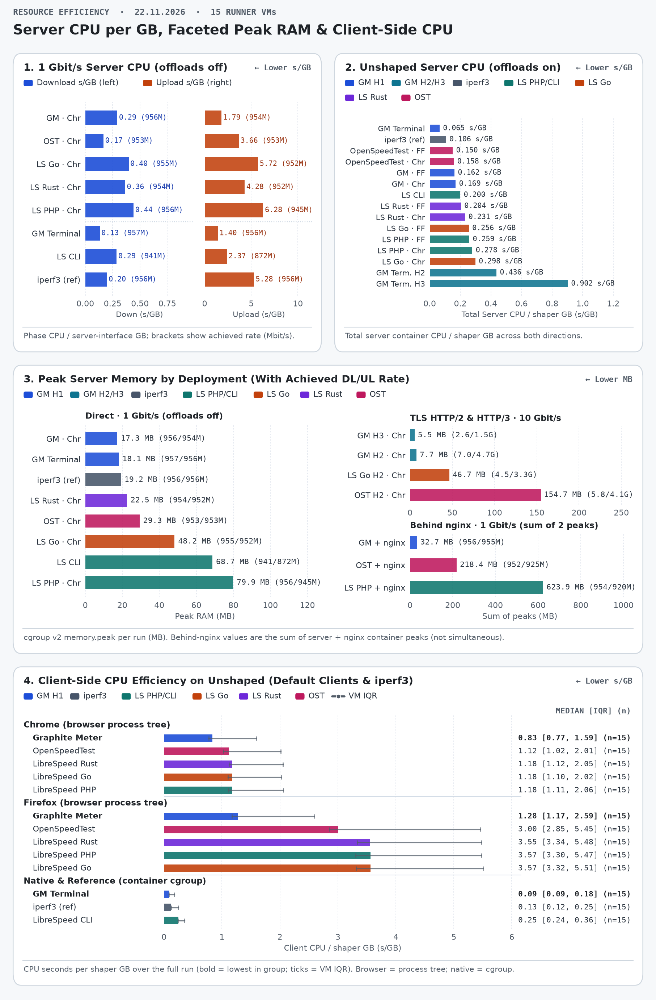
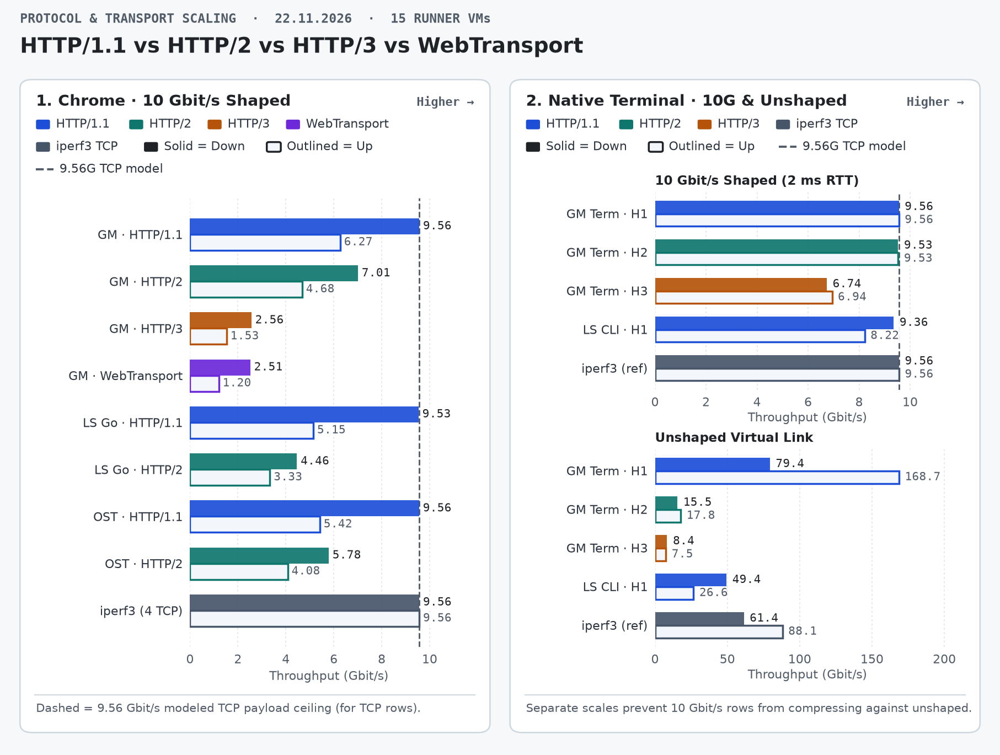
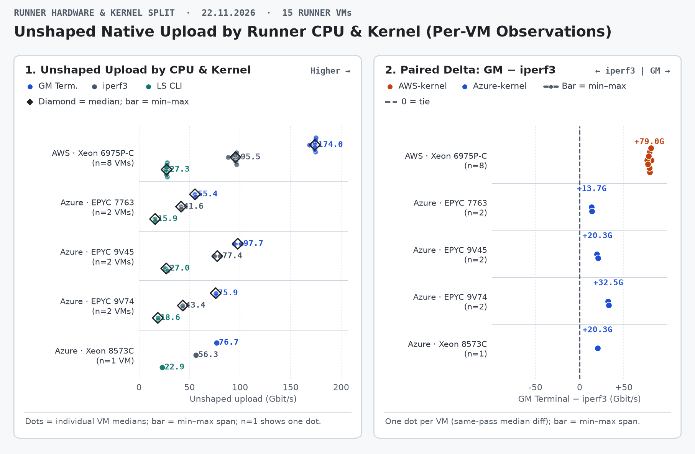
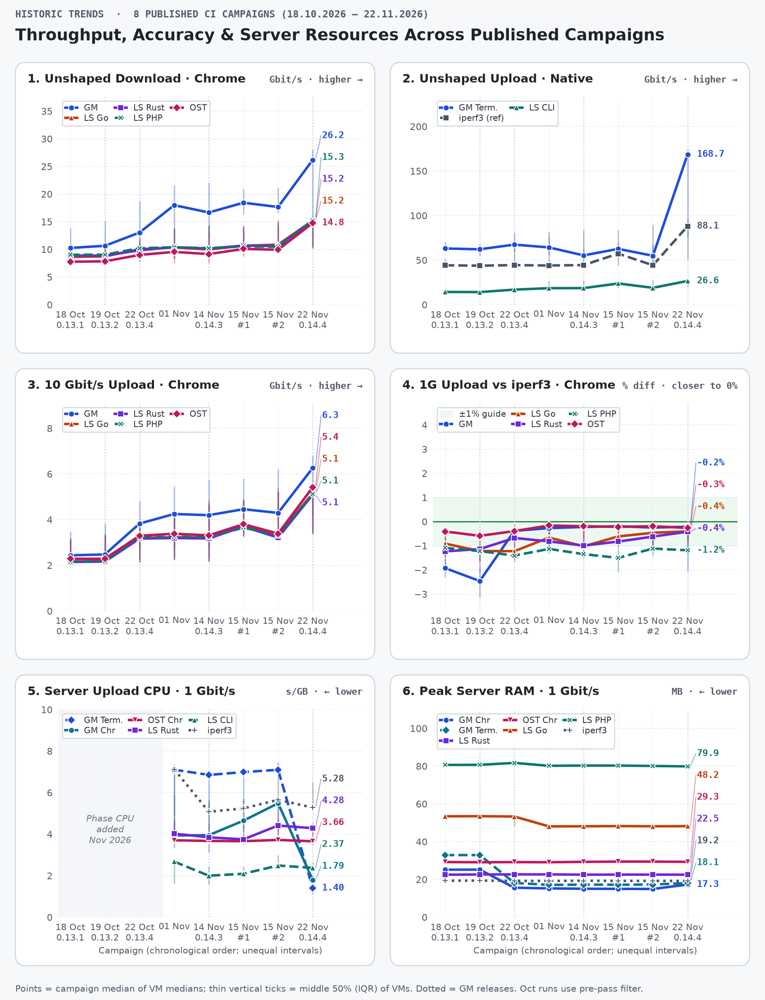

# Self-hosted speed test bench

A comparison of app-reported results for open-source, self-hosted speed tests on controlled virtual network paths.
Each server uses an upstream release. Pinned browsers and native terminal clients share the same paths and runner
resources as separate iperf3 reference runs.

**Conflict of interest:** this repository is maintained by the author of [Graphite Meter](https://github.com/zR-JB/graphite-meter),
one of the tools compared. The harness and adapters are public. Each hosted report links to its run for raw
measurements and generated configs while GitHub retains the artifacts. Corrections are welcome as issues.

[Throughput](#1-high-speed-throughput-10-gbits--unshaped) · [Accuracy & latency](#2-accuracy-hard-links--latency) ·
[Resources](#3-server--client-resource-efficiency) · [Transports](#4-protocol--transport-scaling) ·
[Runner hardware](#5-runner-hardware--kernel-split) · [Historic trends](#historic-trends) ·
[Method](#how-it-works) · [Desktop results](#results-desktop-night-of-18-to-19-october-2026) · [Run it](#run-it)

## Latest GitHub runner results

**22.11.2026** · **5,489/5,490** retained runs completed across **15 runner jobs** (0 runs excluded by the busy-host rule). The 25 and 40 Gbit/s shaped scenarios are skipped on these 4-vCPU runners. They require 8+ CPUs. Each chart plots the median across VMs after reducing each VM’s retained passes to its own median; whiskers and bands show the middle 50% (IQR) across VMs.

[Full report and tested versions](results/2026-11-22-ci-run-44971677456) · [Benchmark source](https://github.com/zR-JB/selfhosted-speedtest-bench/tree/7f25fce927cb5e839d53fe3fa09dcf47acce9349) · [Workflow run and raw artifacts](https://github.com/zR-JB/selfhosted-speedtest-bench/actions/runs/44971677456) · [Previous report](results/2026-11-15-ci-run-43720854999)

- **10 Gbit/s & hard links (default plotted clients):** Chrome download medians reach **9.51–9.56 Gbit/s** (`9.56 Gbit/s` link), while upload medians stop at **5.10–6.27 Gbit/s** in Chrome and **3.96–8.74 Gbit/s** in Firefox with wide VM-to-VM spread. On 1% packet loss among plotted Chrome rows, OpenSpeedTest · Chrome leads both directions with medians of **19.8 / 22.7 Mbit/s**; on 160 ms RTT Chrome upload, OpenSpeedTest · Chrome leads at **276.1 Mbit/s**.
- **Unshaped native runner split:** Pooled medians hide a runner-hardware reversal — Graphite Meter Terminal had a higher upload rate than iperf3 on **15 of 15 VMs** after matching passes. The split was 8/8 on AWS-kernel VMs, 7/7 on Azure-kernel VMs.
- **Server resource trade-offs (1 Gbit/s):** OpenSpeedTest · Chrome uses the lowest Chrome server CPU per GB on download (**0.167 s/GB**) and Graphite Meter Browser · Chrome on upload (**1.794 s/GB**), and Graphite Meter Terminal uses the lowest server CPU during native upload (**1.399 s/GB** at 956 Mbit/s), while Graphite Meter Browser · Chrome uses the lowest peak server RAM with Chrome (**17.3 MB** direct vs 22.5–79.9 MB for other Chrome servers; **32.7 MB** sum of server + nginx peaks vs 218–624 MB).

### 1. High-speed throughput (10 Gbit/s & Unshaped)

<picture>
  <source media="(prefers-color-scheme: dark)" srcset="results/2026-11-22-ci-run-44971677456/chart-throughput-dark.png">
  
</picture>

10 Gbit/s shaped links use 2 ms RTT with offloads on (`9.56 Gbit/s` modeled TCP payload ceiling); unshaped runs remove rate limits on 4-vCPU runners (1 server / 2 client / 1 shaper).
[Shaped summary](results/2026-11-22-ci-run-44971677456/#shaped-throughput) · [10 Gbit/s spread](results/2026-11-22-ci-run-44971677456/#10-gbits-upload-spread) · [Unshaped tables](results/2026-11-22-ci-run-44971677456/#unshaped-throughput-and-client-cpu)

### 2. Accuracy, hard links & latency

<picture>
  <source media="(prefers-color-scheme: dark)" srcset="results/2026-11-22-ci-run-44971677456/chart-accuracy-dark.png">
  
</picture>

On the 30 Mbit/s FIFO path, OpenSpeedTest’s reported upload exceeded the matched iperf3 receiver rate in **30/30 Chrome** and **30/30 Firefox** passes. Matched FIFO passes ran a median of 2.0 minutes apart (maximum 6.6, n=60).
[1 Gbit/s agreement](results/2026-11-22-ci-run-44971677456/#matched-1-gbits-agreement) · [Upload counter checks](results/2026-11-22-ci-run-44971677456/#upload-counter-checks) · [Idle & FIFO latency](results/2026-11-22-ci-run-44971677456/#idle-latency-against-icmp)

### 3. Server & client resource efficiency

<picture>
  <source media="(prefers-color-scheme: dark)" srcset="results/2026-11-22-ci-run-44971677456/chart-resources-dark.png">
  
</picture>

Server CPU is container CPU time per decimal GB of server-interface traffic during each phase (counting both directions), or total container CPU per shaper GB on unshaped. Peak memory is per-run container memory.peak in decimal MB. Client CPU divides browser process-tree CPU (browser rows) or container cgroup CPU (native rows) by shaper GB.
[Full resource tables](results/2026-11-22-ci-run-44971677456/#server-resources-at-1-gbits) · [All server CPU phases](results/2026-11-22-ci-run-44971677456/server-cpu.md) · [Without-loaded-latency delta](results/2026-11-22-ci-run-44971677456/#graphite-meter-without-loaded-latency)

### 4. Protocol & transport scaling

<picture>
  <source media="(prefers-color-scheme: dark)" srcset="results/2026-11-22-ci-run-44971677456/chart-transports-dark.png">
  
</picture>

[1 Gbit/s transports](results/2026-11-22-ci-run-44971677456/#11-gbits-20-ms-rtt-fq_codel) · [10 Gbit/s transports](results/2026-11-22-ci-run-44971677456/#1010-gbits-2-ms-rtt-fq_codel-offloads-on) · [Reverse proxy](results/2026-11-22-ci-run-44971677456/#11-gbits-20-ms-rtt-fq_codel-behind-nginx)

### 5. Runner hardware & kernel split

<picture>
  <source media="(prefers-color-scheme: dark)" srcset="results/2026-11-22-ci-run-44971677456/chart-hardware-dark.png">
  
</picture>

Graphite Meter Terminal had a higher upload rate than iperf3 on **15 of 15 VMs** after matching passes. The split was 8/8 on AWS-kernel VMs, 7/7 on Azure-kernel VMs. [Hardware breakdown](results/2026-11-22-ci-run-44971677456/#unshaped-native-upload-by-runner-hardware) · [All pooled pass tables](results/2026-11-22-ci-run-44971677456/#pooled-pass-tables)

<!-- historic-trends-start -->
## Historic trends

Automatically updated after every full 15-job GitHub runner campaign (**8 campaigns** from **18.10.2026** to **22.11.2026**). Each point is the campaign median of VM medians; vertical ticks show the middle 50% (IQR) of VMs; dotted vertical lines mark Graphite Meter release transitions.

<picture>
  <source media="(prefers-color-scheme: dark)" srcset="results/history-trends-dark.png">
  
</picture>
<!-- historic-trends-end -->

## What runs

| Tool | Deployment | Default concurrency / duration / display factor |
| --- | --- | --- |
| Graphite Meter Browser | `ghcr.io/zr-jb/graphite-meter`, defaults | Adaptive · 10 s · loaded latency on · payload rate |
| LibreSpeed | `ghcr.io/librespeed/speedtest` (`latest`), classic page | 5/3 Chrome, 6/3 Firefox · up to 15 s · factor set to 1.00 |
| LibreSpeed Go backend | Release binary + bundled `settings.toml`, embedded page | 5/3 Chrome, 6/3 Firefox · up to 15 s · factor set to 1.00 |
| LibreSpeed Rust backend | `ghcr.io/librespeed/speedtest-rust`, defaults | 5/3 Chrome, 6/3 Firefox · up to 15 s · factor set to 1.00 |
| OpenSpeedTest | `openspeedtest/latest` (nginx, HTTP/1.1), `?clean` | 6/6 configured · 12 s · `?clean` sets 1.00 |
| Graphite Meter Terminal | Release binary (`--report`) against GM server | Auto (6/6 H1) · 10 s · loaded latency on · payload rate |
| LibreSpeed CLI | Release binary (`--json`) against LibreSpeed PHP | 3 concurrent · 15 s · payload rate |

Exact versions, image digests, browser builds, and checksums are pinned in [`pins.json`](pins.json) and recorded in each run's manifest. Separate without-loaded-latency profiles run Graphite Meter with `--stages download,upload` / idle & loaded probes disabled. Documented TLS transport variants (Graphite Meter H2/H3/WebTransport, LibreSpeed Go H2, OpenSpeedTest H2) use one self-signed certificate per job in Chrome and forced ALPN in the terminal client; Firefox is omitted from QUIC/H2 TLS cells due to test-cert/worker limits. Browsers run headed under Xvfb with a fresh profile per run.

[Graphite Meter browser defaults](https://github.com/zR-JB/graphite-meter/blob/v0.14.4/client/src/app/preferences.ts) ·
[Graphite Meter terminal flags](https://github.com/zR-JB/graphite-meter/blob/v0.14.4/docs/TERMINAL.md#flags) ·
[LibreSpeed web worker](https://github.com/librespeed/speedtest/blob/v6.3.1/speedtest_worker.js) ·
[LibreSpeed CLI flags](https://github.com/librespeed/speedtest-cli/blob/v1.0.15/main.go) ·
[OpenSpeedTest defaults](https://github.com/openspeedtest/Speed-Test/blob/f4263546f50694a154fdd27a03000390949068df/index.html)

## How it works

```
 client container            shaper container                server container
 (browser, iperf3)  <-veth->  tc: netem + tbf  <-veth->  (one tool, fresh each run)
   10.71.1.10        cl: shapes downloads | sv: shapes uploads      10.71.2.10
```

- **Isolation & shaping:** Each role runs in its own Linux network namespace (`--network none`), joined by direct 1,500-byte MTU veth pairs with fixed per-role CPU sets and memory caps. The shaper splits RTT across both sides (`netem`), applies the rate (`tbf`), and queues with `fq_codel` or fixed-depth FIFO. Offloads are off up to 1 Gbit/s and under packet loss, and on for 10/25/40 Gbit/s and unshaped paths.
- **Pass ordering & host-noise filtering:** Every VM runs two passes across all scenarios (second pass reverses tool order) with a separate seed. A whole pass is discarded if pre- or post-pass CPU probes exceed 125% of that VM's median, hypervisor CPU steal exceeds 5%, or the clean-link `iperf3` control falls below 75% of the modeled ceiling.
- **Comparability & automation:** Tools keep their own durations and stream counts; adapters ([`bench/driver/adapters`](bench/driver/adapters)) press each UI's start button or parse native CLI reports. `iperf3` uses 4 parallel TCP streams (10 s measured after 2 s omit) as a receiver-side reference. Campaigns run monthly ([`bench.yml`](.github/workflows/bench.yml)) and on pin updates ([`watch.yml`](.github/workflows/watch.yml)), gated by [`smoke.yml`](.github/workflows/smoke.yml) and published automatically by [`publish-report.yml`](.github/workflows/publish-report.yml).

| Measure | Definition & reference |
| --- | --- |
| Throughput | Modeled TCP payload ceiling (`1,448 / 1,514` Ethernet frame with IPv4 + TCP timestamps) where `iperf3` reaches it; otherwise compared against same-pass `iperf3` and peer tools. |
| Idle & loaded latency | Idle baseline = minimum of 10 ICMP pings before each pass. On FIFO paths, loaded RTT reference = idle baseline + 100 ms-sampled median FIFO queue delay (`fq_codel` has no equivalent loaded reference). |
| Independent transfer rate | Passive server-interface byte counter during sustained intervals (includes protocol overhead; distinct timing window from the app). |
| Server CPU & RAM | Server container cgroup v2 CPU seconds per GB moved (split into download/upload/other phases at 100 ms intervals) and per-run `memory.peak` (behind-nginx sums both containers' peaks). |
| Client CPU | CPU seconds per shaper GB: browser process tree for browser runs, and container cgroup v2 CPU + peak memory for native terminal clients and `iperf3` (from November 2026 onward). |

Scenarios live in [`scenarios.json`](scenarios.json) (100 Mbit/s, 1/10/25/40 Gbit/s, 300/30 FIFO, 1% & 0.1% loss, 160 ms RTT, competing traffic, nginx reverse proxy, two-server catalogue, unshaped). Virtual links cannot capture real NIC, Wi-Fi, or switch behaviour. (Earlier single-pass receiver-counter smoke validation: [`results/2026-11-14-upload-counter-smoke.json`](results/2026-11-14-upload-counter-smoke.json).)

## Results: desktop, night of 18 to 19 October 2026

A second full campaign on an **AMD Ryzen 7 7800X3D** desktop (8 cores / 16 threads, kernel `7.2.10-1-cachyos`, rootless Podman, 3 browser cores, 6 reps = **1,074/1,074** completed runs, including **25 and 40 Gbit/s** paths skipped on 4-vCPU runners) is archived in [`results/2026-10-18-desktop-7800x3d`](results/2026-10-18-desktop-7800x3d). On 1% packet loss, `iperf3` reached **94 Mbit/s** on this desktop versus **~13 Mbit/s** on GitHub runners — illustrating why loss, high-RTT, and deep-buffer results should only be compared within the same testbed.

## Run it

Requires Linux with cgroup v2, Podman (`SB_ROOTFUL=1` for rootful), Node 22+, `nsenter`, `ethtool`, `curl`, `unzip`, and `xz`. Use `SB_PREFIX`, `SB_CPUSETS`, and `SB_PIN_OVERRIDES` for isolated or custom-build runs.

```sh
node bench/run.js --scenarios accuracy-100 --reps 1
node bench/summarize.js results/local-*
node bench/phases.js results/local-*
```
