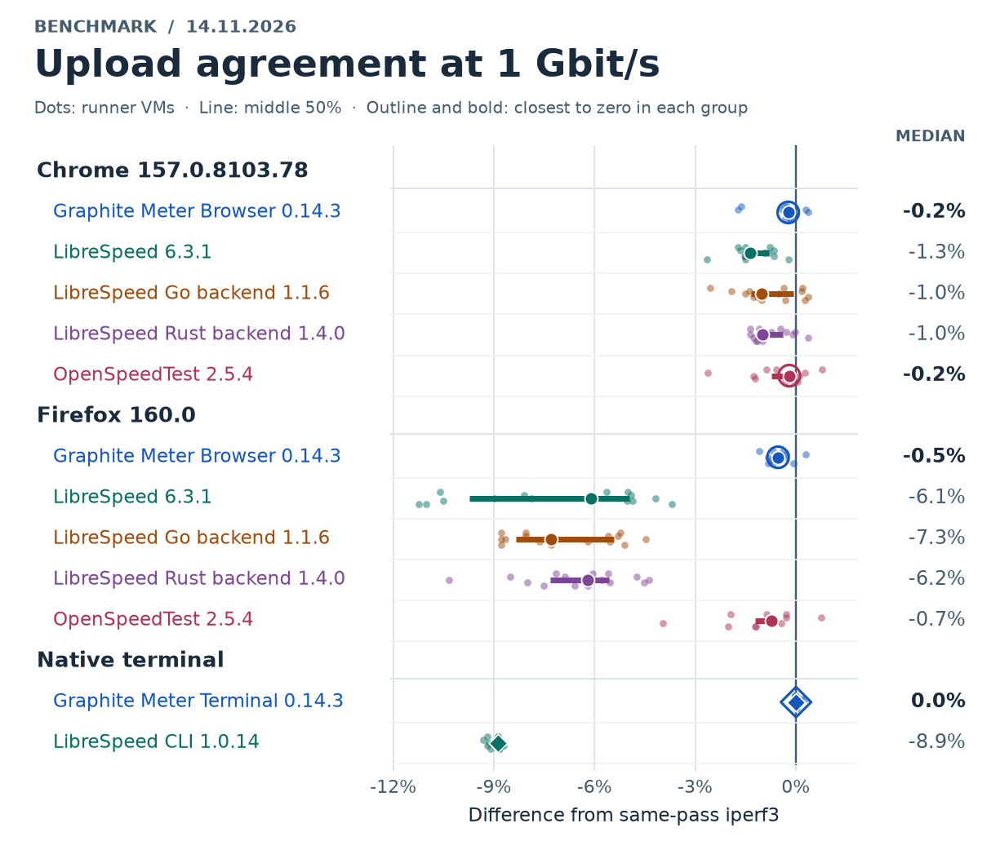
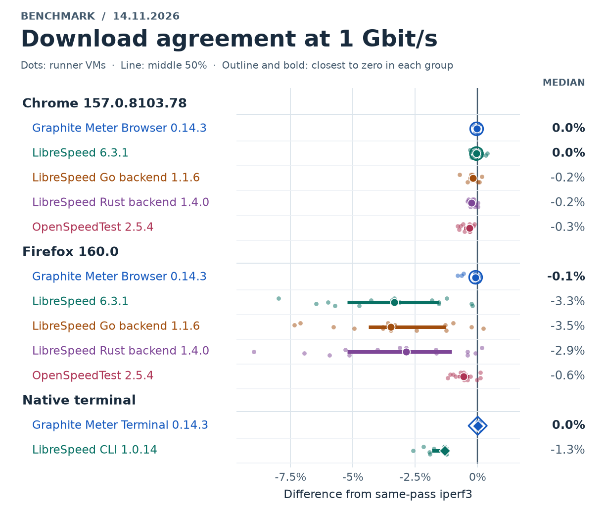
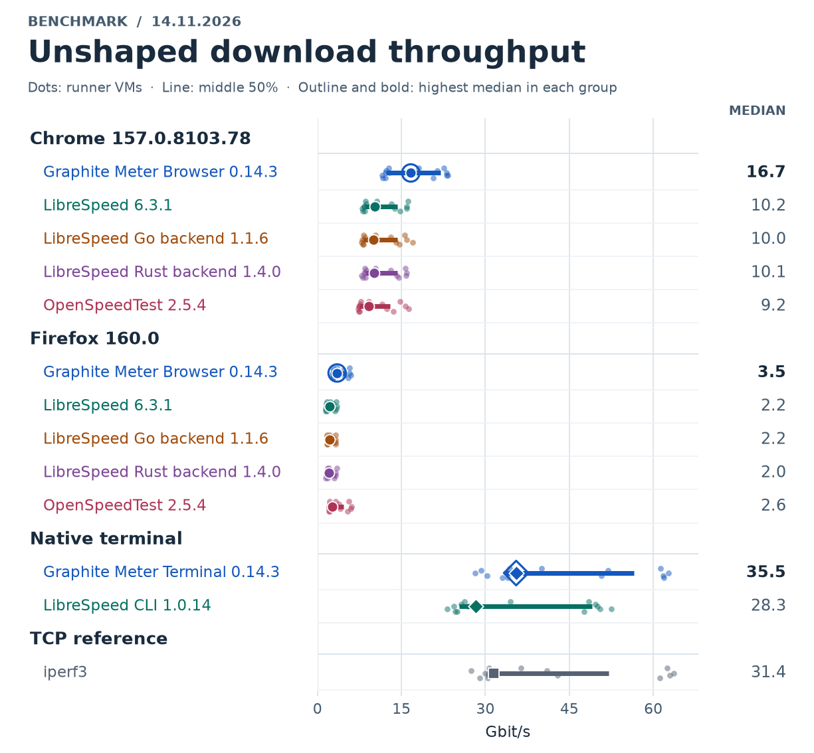
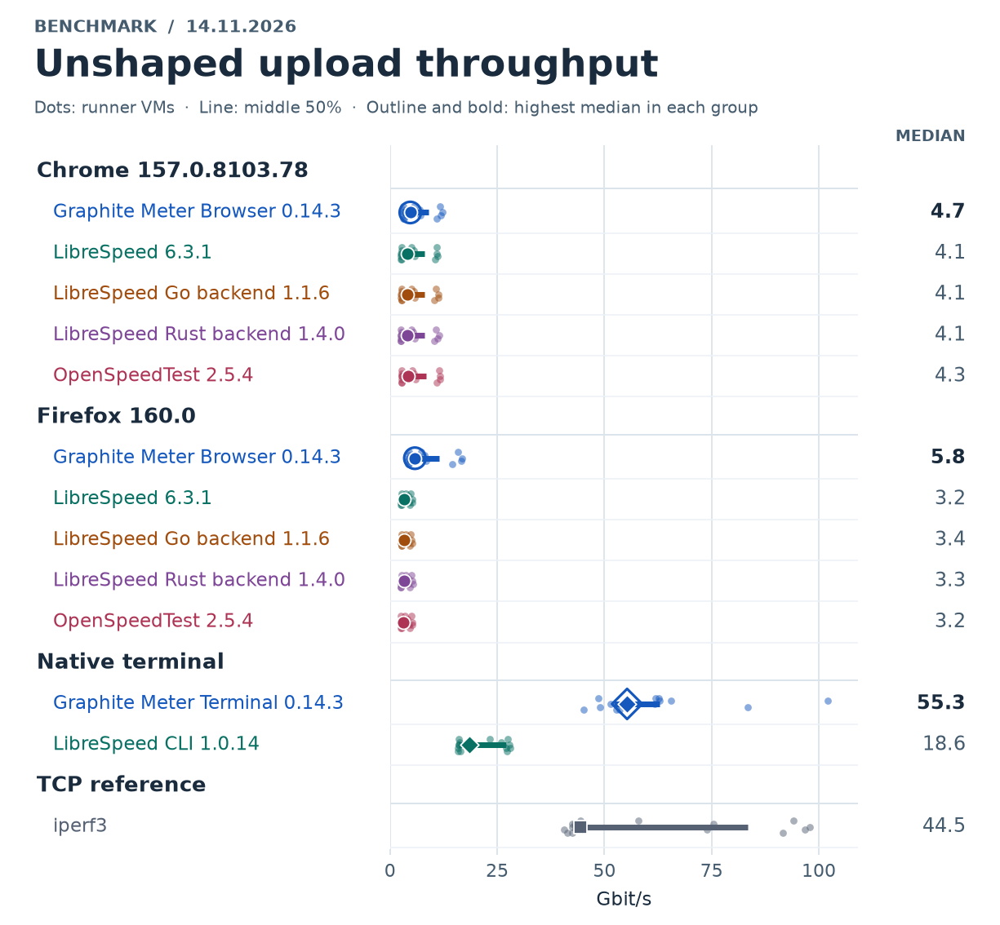
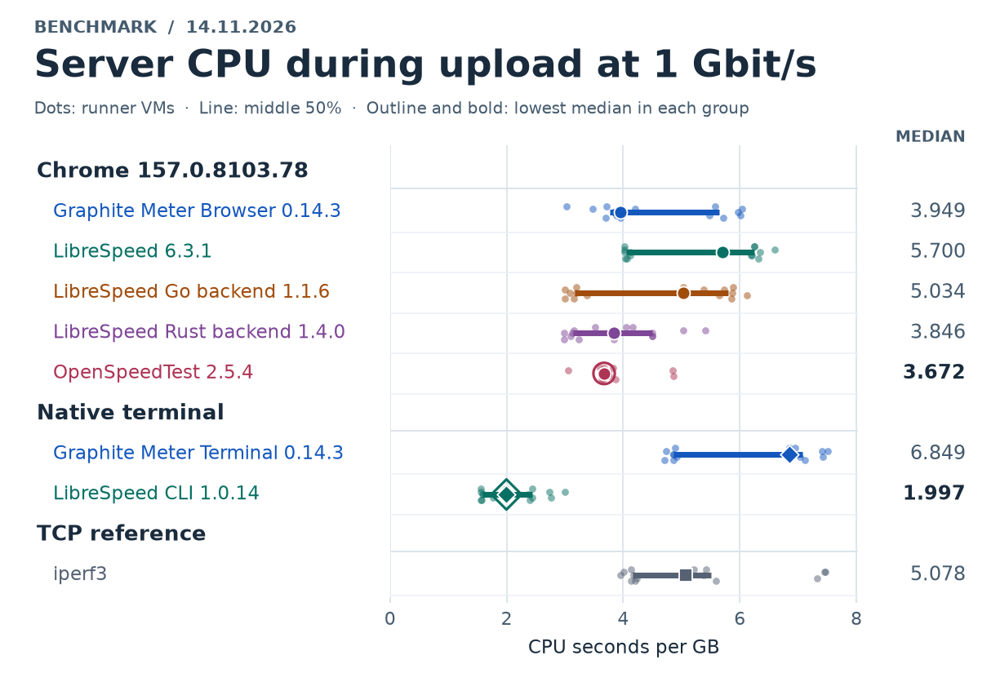
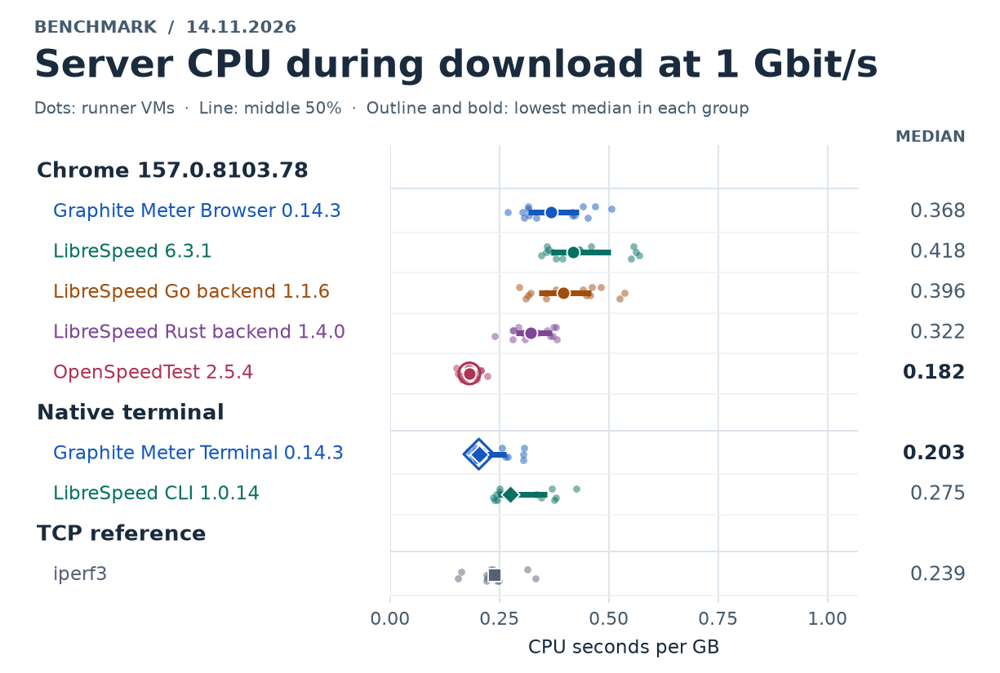
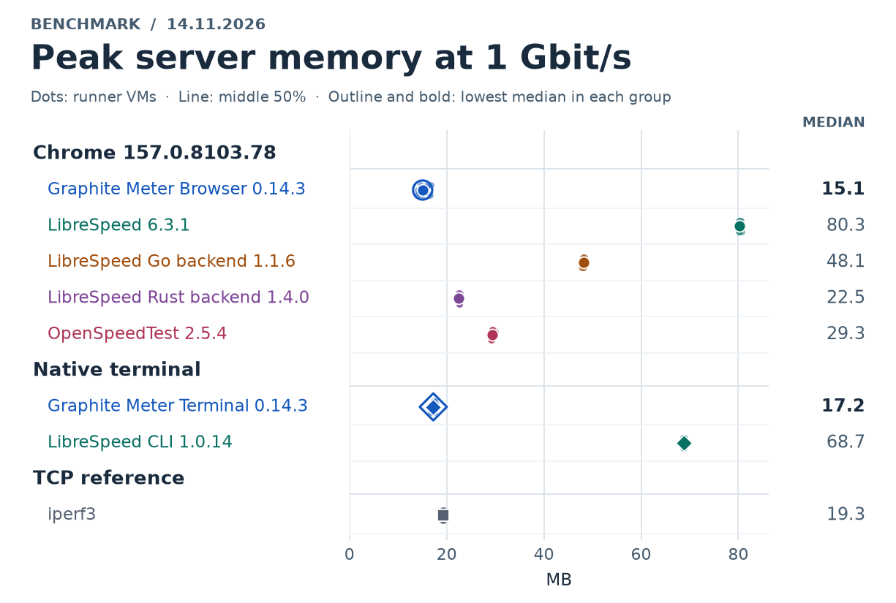

# Self-hosted speed test bench

A comparison of app-reported results for open-source, self-hosted speed tests on controlled virtual network paths.
Each server uses an upstream release. Pinned browsers and native terminal clients share the same paths and runner
resources as separate iperf3 reference runs.

**Conflict of interest:** this repository is maintained by the author of [Graphite Meter](https://github.com/zR-JB/graphite-meter),
one of the tools compared. The harness and adapters are public. Each hosted report links to its run for raw
measurements and generated configs while GitHub retains the artifacts. Corrections are welcome as issues.

[Shaped throughput](#shaped-throughput) · [Agreement at 1 Gbit/s](#agreement-at-1-gbits) ·
[Unshaped throughput](#unshaped-throughput) · [Server resources](#server-resources-at-1-gbits) ·
[Upload check](#openspeedtest-upload-check) · [Latency](#idle-and-loaded-latency) ·
[Method](#how-it-works) · [Desktop results](#results-desktop-night-of-18-to-19-october-2026) · [Run it](#run-it)

## Latest GitHub runner results

**14.11.2026.** **4,530/4,530** retained runs completed across **15 runner jobs** (0 runs excluded by the busy-host rule).
The 25 and 40 Gbit/s shaped scenarios are skipped on these 4-vCPU runners. They require 8+ CPUs.

[Full report and tested versions](results/2026-11-14-ci-run-43601751633) · [Benchmark source](https://github.com/zR-JB/selfhosted-speedtest-bench/tree/6f9063202cdedffd4c7957dedd57758cef9b9a44) · [Workflow run and raw artifacts](https://github.com/zR-JB/selfhosted-speedtest-bench/actions/runs/43601751633) · [Previous report](results/2026-11-01-ci-run-41295946781)

**Browsers** · Chrome 157.0.8103.78 · Firefox 160.0

**Tested tools** · Graphite Meter Browser 0.14.3 · LibreSpeed 6.3.1 · LibreSpeed Go backend 1.1.6 · LibreSpeed Rust backend 1.4.0 · OpenSpeedTest 2.5.4 · Graphite Meter Terminal 0.14.3 · LibreSpeed CLI 1.0.14

[Exact pins and reference version](results/2026-11-14-ci-run-43601751633/#tested-versions)

### Shaped throughput

On the 10 Gbit/s path, reported median uploads ranged from **3.17–4.19 Gbit/s in Chrome** and
**2.85–5.09 Gbit/s in Firefox**. Graphite Meter Terminal
reported **9.56 Gbit/s** and LibreSpeed CLI **7.88 Gbit/s**.
Graphite Meter Browser’s same-pass upload difference from OpenSpeedTest in Chrome was **+0.69 Gbit/s** (middle 50% +0.38 to +0.80). Graphite Meter Browser reported more on **15/15 matched VMs**. [Upload spread across VMs](results/2026-11-14-ci-run-43601751633/#10-gbits-upload-spread)

Each throughput cell shows **download / upload**. Browser rows use default Chrome. The two terminal
clients use their native defaults. The 1 Gbit/s link uses a 20 ms RTT and has a payload ceiling of
about 956 Mbit/s. The 10 Gbit/s test uses a 2 ms RTT and offloads. iperf3 uses four TCP streams.
Bold marks the highest displayed median in each direction within browser or terminal, including rounded ties.
The iperf3 row is a reference.

| Tool or client | 1 Gbit/s (Mbit/s) | 10 Gbit/s (Gbit/s) | 1% loss (Mbit/s) |
| --- | ---: | ---: | ---: |
| Graphite Meter Browser | **956.1** / 954.4 | **9.56** / **4.19** | 13.4 / 13.9 |
| LibreSpeed | 956.0 / 943.5 | 9.14 / 3.23 | 16.6 / 9.5 |
| LibreSpeed Go backend | 954.5 / 946.5 | 9.20 / 3.22 | 16.9 / 9.5 |
| LibreSpeed Rust backend | 954.0 / 947.0 | 9.39 / 3.17 | 16.9 / 9.6 |
| OpenSpeedTest | 953.2 / **954.5** | 9.27 / 3.31 | **18.7** / **21.5** |
| Graphite Meter Terminal | **956.4** / **956.5** | **9.56** / **9.56** | **20.0** / **20.0** |
| LibreSpeed CLI | 943.8 / 871.5 | 9.36 / 7.88 | 11.2 / 11.8 |
| iperf3 (reference) | 956.4 / 956.4 | 9.56 / 9.56 | 13.0 / 12.8 |

The loss test uses a 100 Mbit/s link, 1% loss in each direction and 40 ms RTT. Chrome reported
**21.5 Mbit/s** upload with OpenSpeedTest and
**13.9 Mbit/s** with Graphite Meter Browser.
Connection counts and test windows can change rates on lossy paths.

We take each VM’s median over its retained passes, then summarize across VMs. A VM contributes once,
with up to two passes. Large marks show medians across VMs. Lines span the middle 50%, and small
marks show VM values where plotted. The spreads describe these runners. Sample sizes and exact
values are in the linked tables.

Tools keep their own test durations, connection counts and probes. Graphite Meter keeps loaded probes
enabled in both clients. The other adapters record idle latency. The benchmark disables LibreSpeed
and OpenSpeedTest’s throughput compensation. [Deployment settings](#what-runs)

### Agreement at 1 Gbit/s

Chrome’s median upload differences from iperf3 spanned **-1.3% to -0.2%**. In Firefox, the three
LibreSpeed deployments spanned **-7.3% to -6.1%**.

[Agreement values for every tool](results/2026-11-14-ci-run-43601751633/#matched-1-gbits-agreement)

[](results/2026-11-14-ci-run-43601751633/agreement-upload.png)

<details open>
<summary>View download agreement</summary>

[](results/2026-11-14-ci-run-43601751633/agreement-download.png)

</details>

Zero matches the iperf3 receiver payload rate. Positive values mean the app reported a higher rate.
The comparison reflects both the traffic each setup drove and its reporting method.
Tests ran sequentially. App and iperf3 start times were a median of 2.5 minutes apart (maximum 8.4).

### Unshaped throughput

Median download / upload was **35.5 / 55.3 Gbit/s** for Graphite Meter Terminal,
**28.3 / 18.6 Gbit/s** for LibreSpeed CLI and **31.4 / 44.5 Gbit/s** for iperf3.
Graphite Meter Terminal had a higher upload rate than iperf3 on **11 of 15 VMs** after matching passes. The split was 0/4 on AWS-kernel VMs, 11/11 on Azure-kernel VMs.

[Unshaped medians, maxima and browser CPU](results/2026-11-14-ci-run-43601751633/#unshaped-throughput-and-browser-cpu)

[](results/2026-11-14-ci-run-43601751633/unshaped-download.png)

<details open>
<summary>View unshaped upload throughput</summary>

[](results/2026-11-14-ci-run-43601751633/unshaped-upload.png)

</details>

Unshaped runs remove the rate limit and artificial delay, with offloads enabled. The runner gives the
server one vCPU and the client two. The tool, client, server and VM can all affect the observed rate.
These are single-test results on a virtual link. Production capacity also depends on the network and
simultaneous demand.

Graphite Meter Terminal times downloads at the client and uploads at the server. iperf3 reports
the receiver in both directions. [Native upload by runner hardware](results/2026-11-14-ci-run-43601751633/#unshaped-native-upload-by-runner-hardware)

### Server resources at 1 Gbit/s

With Chrome, Graphite Meter Browser’s median peak memory was **15.1 MB**. The LibreSpeed deployments ranged from 22.5–80.3 MB. OpenSpeedTest used **0.182 CPU s/GB** on download and **3.672 CPU s/GB** on upload.

Graphite Meter Terminal used **6.849 CPU s/GB** on upload at **956.5 Mbit/s**. LibreSpeed CLI used **1.997 CPU s/GB** at **871.5 Mbit/s**.

[Server resource values for Chrome, Firefox and terminals](results/2026-11-14-ci-run-43601751633/#server-resources-at-1-gbits)

[](results/2026-11-14-ci-run-43601751633/server-upload-cpu.png)

<details open>
<summary>View server CPU during download</summary>

[](results/2026-11-14-ci-run-43601751633/server-download-cpu.png)

</details>

<details open>
<summary>View peak server memory</summary>

[](results/2026-11-14-ci-run-43601751633/server-peak-memory.png)

</details>

Server CPU is container CPU time per decimal GB of server-interface traffic during each phase,
counting bytes in both directions. Peak memory is the container’s per-run peak in decimal MB.
The adjacent reported rates show how much of the same shaped link each setup used. Browser CPU is
measured separately on the client. Native client CPU is unavailable.

Over the full Chrome test the median total server CPU time was **6.01 s** for OpenSpeedTest and **3.47 s** for Graphite Meter Browser. Total time reflects both the amount of data moved and the work per byte.

Bold marks the lowest displayed median per resource within each client group.

| Tool or client | Down / up (Mbit/s) | Down CPU (s/GB) | Up CPU (s/GB) | Peak RAM (MB) |
| --- | ---: | ---: | ---: | ---: |
| Graphite Meter Browser · Chrome | 956.1 / 954.4 | 0.368 | 3.949 | **15.1** |
| LibreSpeed · Chrome | 956.0 / 943.5 | 0.418 | 5.700 | 80.3 |
| LibreSpeed Go backend · Chrome | 954.5 / 946.5 | 0.396 | 5.034 | 48.1 |
| LibreSpeed Rust backend · Chrome | 954.0 / 947.0 | 0.322 | 3.846 | 22.5 |
| OpenSpeedTest · Chrome | 953.2 / 954.5 | **0.182** | **3.672** | 29.3 |
| Graphite Meter Terminal | 956.4 / 956.5 | **0.203** | 6.849 | **17.2** |
| LibreSpeed CLI | 943.8 / 871.5 | 0.275 | **1.997** | 68.7 |
| iperf3 (reference) | 956.4 / 956.4 | 0.239 | 5.078 | 19.3 |

[All server CPU phases](results/2026-11-14-ci-run-43601751633/server-cpu.md)

### OpenSpeedTest upload check

On the FIFO path, OpenSpeedTest’s reported rate exceeded the matched iperf3 receiver rate in **30/30 Chrome** and **30/30 Firefox** passes.

**1 Gbit/s path**

| Tool or client | App rate | Shaper | Above iperf3 |
| --- | ---: | ---: | ---: |
| OpenSpeedTest · Chrome | 954.5 | 972.9 | 7/30 |
| OpenSpeedTest · Firefox | 949.5 | 974.3 | 3/30 |
| iperf3 (reference) | 956.4 | 972.4 | — |

**30 Mbit/s upload, deep FIFO**

| Tool or client | App rate | Shaper | Above iperf3 |
| --- | ---: | ---: | ---: |
| OpenSpeedTest · Chrome | 31.0 | 30.8 | 30/30 |
| OpenSpeedTest · Firefox | 30.8 | 30.8 | 30/30 |
| iperf3 (reference) | 28.7 | 30.9 | — |

All rates are in Mbit/s. The shaper reports the median over busy intervals, includes protocol
overhead and can show rates above the configured limit even for iperf3. “Above iperf3” counts passes
where the tool reported a higher rate than the same-VM, same-pass iperf3 receiver. Each VM runs
its two passes sequentially. The separate receiver smoke used the 1 Gbit/s path only.
This run predates passive server-interface timing. A payload accounting check would require
receiver payload bytes over the app’s reporting window.
[Counter data for all tools](results/2026-11-14-ci-run-43601751633/#upload-counter-checks) ·
[Instrumented receiver check](#receiver-counter-validation)

### Idle and loaded latency

The idle baseline is the minimum of ten ICMP pings before each scenario pass. Browser and terminal
probes can include additional protocol and processing time. On the FIFO path, the loaded estimate adds the
same run’s median queue delay to that baseline. The app and queue sampler use distinct timing windows. Fair queuing can put
probe traffic in a separate queue, so fq_codel runs lack a loaded-latency reference. [Idle comparisons at 20, 40 and 160 ms](results/2026-11-14-ci-run-43601751633/#idle-latency-against-icmp)

Graphite Meter reports loaded latency during download and upload in this run. On the 300/30 Mbit/s path
with a 200 ms FIFO, each cell shows the app’s median followed by the queue-based estimate.

| Tool or client | During download (ms) | During upload (ms) |
| --- | ---: | ---: |
| Graphite Meter Browser · Chrome | 162.2 / 154.5 | 184.9 / 181.3 |
| Graphite Meter Browser · Firefox | 170.0 / 159.5 | 184.5 / 180.6 |
| Graphite Meter Terminal | 175.0 / 169.5 | 197.5 / 193.2 |

On the 10 Gbit/s path, Graphite Meter Browser in Chrome reported median upload of
**4.19 Gbit/s over HTTP/1.1**, **2.63 over HTTP/2**,
**0.74 over HTTP/3**, and **0.70 over WebTransport**.
[1 Gbit/s transport comparison](results/2026-11-14-ci-run-43601751633/#11-gbits-20-ms-rtt-fq_codel) ·
[Reverse-proxy results](results/2026-11-14-ci-run-43601751633/#11-gbits-20-ms-rtt-fq_codel-behind-nginx) ·
[Additional paths](results/2026-11-14-ci-run-43601751633/#pooled-pass-tables)

## What runs

| Tool | Deployment |
| --- | --- |
| Graphite Meter Browser | `ghcr.io/zr-jb/graphite-meter`, defaults |
| LibreSpeed | `ghcr.io/librespeed/speedtest` (`latest` image), defaults (classic page), overhead factor 1 |
| LibreSpeed Go backend | Release binary with its bundled `settings.toml` (no public image), serving its embedded page, overhead factor 1 |
| LibreSpeed Rust backend | `ghcr.io/librespeed/speedtest-rust`, defaults, overhead factor 1 |
| OpenSpeedTest | `openspeedtest/latest`, defaults (nginx, HTTP/1.1), `?clean` |
| Graphite Meter Terminal | Release binary, `--report`, against the Graphite Meter server |
| LibreSpeed CLI | Release binary, `--json`, against the LibreSpeed (PHP) server |

Tables compare against a modeled TCP payload ceiling on paths where iperf3 reaches it. Current versions, image digests,
browser builds and checksums are in
[`pins.json`](pins.json); each results section names the versions it ran, and each run's manifest records them exactly.

Transport variants, each set up only as its project documents, in Chrome in the 1, 10, 25 and 40 Gbit/s scenarios and at
0.1 % loss, and for Graphite Meter's terminal client in those scenarios and the unshaped one:

| Variant | Setup | Protocol evidence |
| --- | --- | --- |
| Graphite Meter, HTTP/2 / HTTP/3 / WebTransport | Native TLS listeners (`GM_H1_TLS_ADDR`, `GM_H2_ADDR`, `GM_H3_ADDR`), page over HTTPS, connection path set in its settings | The browser-observed protocol in each saved result |
| LibreSpeed Go backend, HTTP/2 | `enable_tls` and `enable_http2` in its `settings.toml` | The server's negotiated protocol, checked with curl before each run |
| OpenSpeedTest, HTTP/2 | `http2` on its TLS listener plus its documented upload fix, in its nginx config | The same curl check |
| Graphite Meter terminal client, HTTP/2 / HTTP/3 | The same native listeners; `--throughput-protocol`, `--throughput-transport fetch-stream` and `--latency-transport websocket`, as the browser variants set their connection path | The client offers only that protocol in its TLS handshake, so it cannot fall back |

All TLS uses one self-signed certificate per job; Chrome trusts its key by hash and the terminal client takes it with
its documented `--insecure`. Firefox is left out of these cells: it does not accept a test certificate for QUIC, and
Graphite Meter's own tests keep its HTTP/2 cells Chrome-only for a Firefox worker bug. LibreSpeed's PHP image and Rust
backend document no HTTP/2 setting and are not in this profile.

### Default test settings

The headline comparison uses the applications as configured below. Transfer stages use HTTP/1.1 on the plain test
path. The connection counts are configured settings. The harness does not count active connections in each run.

| Client | Download / upload concurrency | Duration per direction | Latency during transfers | Display compensation |
| --- | --- | --- | --- | --- |
| Graphite Meter Browser | Adaptive | 10 s target | Enabled | Payload rate |
| LibreSpeed PHP, Go and Rust browsers | 5 / 3 in Chrome, 6 / 3 in Firefox in the bundled worker defaults | Up to 15 s, with adaptive timing | Idle only | Set to 1.00 |
| OpenSpeedTest | 6 / 6 configured | 12 s configured | Idle only | `?clean` sets 1.00 |
| Graphite Meter Terminal | 6 / 6 on the default HTTP/1.1 path | 10 s target | Enabled | Payload rate |
| LibreSpeed CLI | 3 concurrent HTTP requests | 15 s | Idle only | Payload rate |

Graphite Meter runs latency probes during throughput and includes their cost in its defaults. A probes-on/off
comparison uses the same server release and browser transport. The **Graphite Meter without loaded latency** profile skips
the app’s idle-latency stage and its loaded probes. The harness still measures idle path RTT independently. The separate transport
variants use the documented settings above. The LibreSpeed web worker’s display factor defaults to 1.06, and
the OpenSpeedTest page defaults to 1.04. The harness uses each application's adjustment for payload-rate display.

[Graphite Meter browser defaults](https://github.com/zR-JB/graphite-meter/blob/v0.14.3/client/src/app/preferences.ts) ·
[Graphite Meter terminal flags](https://github.com/zR-JB/graphite-meter/blob/v0.14.3/docs/TERMINAL.md#flags) ·
[LibreSpeed web worker](https://github.com/librespeed/speedtest/blob/v6.3.1/speedtest_worker.js) ·
[LibreSpeed CLI flags](https://github.com/librespeed/speedtest-cli/blob/v1.0.14/main.go) ·
[OpenSpeedTest defaults](https://github.com/openspeedtest/Speed-Test/blob/f4263546f50694a154fdd27a03000390949068df/index.html)

Browsers: Chrome for Testing and Firefox release builds, fresh profile per run, headed under Xvfb.

## How it works

```
 client container            shaper container                server container
 (browser, iperf3)  <-veth->  tc: netem + tbf  <-veth->  (one tool, fresh each run)
   10.71.1.10        cl: shapes downloads | sv: shapes uploads      10.71.2.10
```

- One Linux host; each role has its own network namespace, joined by direct veth pairs with a 1,500 byte MTU.
  Containers start with `--network none` and the harness wires them; no container bridge, port publishing or NAT is in
  the path. The same network setup applies to every tool.
- The shaper applies half the RTT on each side (`netem`), the rate (`tbf`), and the queue: a FIFO of fixed depth, or
  `fq_codel`. Segmentation offloads are off up to 1 Gbit/s and wherever loss applies, so shaping and loss act on real
  frames; the 10, 25 and 40 Gbit/s and unshaped scenarios turn them on, as real network cards do.
- CPU sets and memory caps are fixed per role (shaper, server, client) and the same for every tool.
- Every runner job tests every eligible tool and browser and an iperf3 reference on the same VM. The first pass visits every scenario. The next pass reverses the tool order within each scenario.
  Each VM uses a separate seed. The overview takes a median per VM before summarizing across VMs. The full scenario
  tables pool retained passes. Both leave out a whole pass when its pre-pass CPU probe takes more than 125% of that
  VM’s median. The probe samples host load before a pass and can miss later variation.
- The iperf3 reference records receiver payload with four parallel TCP streams and a 10-second measured window,
  after omitting the first two seconds. The tools image installs the distro’s iperf3 and traffic-control packages.
  The historical manifests record the runner image and kernel. They do not record the exact versions of those packages.
- Each tool is pressed through its own start button; results are read from what the page shows or saves. Adapters are
  in [`bench/driver/adapters`](bench/driver/adapters). Graphite Meter Browser’s adapter reads the saved measurement at
  full precision. The other browser adapters read the rounded display values. Terminal clients run in the client's
  namespace and their own report is parsed.
- The proxy scenario puts the same nginx in front of every tool whose project documents a proxy setup, with only the
  directives that project's documentation asks for (recorded in `pins.json`). iperf3 bypasses nginx and measures the
  direct shaped path as a control.
- The competing-traffic scenario adds one bulk TCP flow each way through the same bottleneck for the whole run.
- The two-server scenario gives each server its own 200 Mbit/s path. Only tools that measure several servers at once
  run in it (Graphite Meter, through its documented server catalogue); the others test one server at a time.
- After every run the harness checks that nothing was left behind (browser processes, helper containers, sampler
  loops) and stops the job otherwise; three harness errors in a row also stop it. A full bench only starts after a
  [smoke](.github/workflows/smoke.yml) of every tool and every scenario passes with no harness error.
- Bench verifies the committed pins against the current stable releases before starting smoke tests. The
  [release watcher](.github/workflows/watch.yml) checks every Monday at 04:00 UTC and can also run on demand.
  It proposes pin updates in a pull request. Merging a pin update starts a new Bench run. The regular benchmark
  runs on the first of each month at 03:00 UTC. The [report workflow](.github/workflows/publish-report.yml) publishes
  updated tables and charts after each successful full run.

## What is compared

| Measure | Reference |
| --- | --- |
| Download and upload | Modeled TCP payload ceiling of 1,448 bytes per 1,514-byte Ethernet frame, with IPv4 and TCP timestamps. Used where iperf3 reaches the modeled rate. |
| Download and upload with loss, a long path or competing traffic | Compare achieved rates with the other tools and iperf3 in the same scenario. Loss, delay and competing traffic can limit throughput below the configured rate. Under competition, the raw data also record each run’s median share measured on the shaper. |
| Idle latency | Minimum of ten ICMP pings, 200 ms apart, on the same shaped path before each pass. App readings can include browser timing limits and server handling. |
| Latency under load | Idle ICMP baseline plus the FIFO queue delay sampled every 100 ms during the transfer. This is an estimate of path RTT. The benchmark has no equivalent loaded reference under `fq_codel`. |
| Independent transfer rate | Passive server interface byte counter over sustained intervals for each direction. It includes transport overhead and is separate from the app’s own reporting window. Skipped for competing traffic, where another flow shares that interface. |
| Server CPU and memory | The server container's cgroup: CPU seconds per GB moved, peak memory; each run also splits that CPU by 100 ms samples into download, upload and other phases, which `bench/phases.js` tables |
| Browser CPU (client side) | CPU seconds per GB of the browser's process tree, reported in the full uncapped tables. Native client CPU is not collected. |

Scenarios are in [`scenarios.json`](scenarios.json): 100 Mbit/s and 1 Gbit/s at 20 ms RTT; 10, 25 and 40 Gbit/s at
2 ms (25 and 40 only on hosts with at least 8 CPUs); 300/30 Mbit/s behind a 200 ms FIFO; 1 % and 0.1 % loss at 40 ms;
a 160 ms path; competing traffic; a reverse proxy; two servers; and an unshaped run. This testbed cannot show real
network card, Wi-Fi or switch behaviour, and the unshaped scenario measures observed throughput on its host-local virtual network.

### Receiver-counter validation

The [14 November instrumentation smoke](https://github.com/zR-JB/selfhosted-speedtest-bench/actions/runs/43607039717)
ran one pass at 1 Gbit/s with the same release pins as the monthly comparison. It used the newer harness revision
[`b077cceb`](https://github.com/zR-JB/selfhosted-speedtest-bench/commit/b077cceb), which records passive server interface
bytes and time during sustained upload. This single pass did not exercise the 30 Mbit/s FIFO scenario.
[Smoke measurements and exact pins](results/2026-11-14-upload-counter-smoke.json)

| Test | Reported upload, Mbit/s | Server interface, Mbit/s |
| --- | ---: | ---: |
| OpenSpeedTest, Chrome | 947.8 | 951.8 |
| OpenSpeedTest, Firefox | 965.6 | 945.1 |
| iperf3 | 955.4 | 979.0 |

The Firefox gap flags a difference worth investigating. The interface counts protocol overhead over a different window
than the app’s payload report, so the difference alone does not quantify reporting error. Future full runs save both
directions of this independent measurement for every eligible tool.

## Results: desktop, night of 18 to 19 October 2026

A second dataset from an AMD Ryzen 7 7800X3D desktop (8 cores, 16 threads, kernel 7.2.10-1-cachyos, rootless Podman),
with the browser on three cores instead of the runners' two vCPUs, the same tools and versions as the 18 October
runner run (Graphite Meter 0.13.1, Chrome 155, Firefox 158.0), and the 25 and 40 Gbit/s scenarios: 6 runs per tool,
browser and scenario, 1,074 runs, all complete. Full tables and setup:
[`results/2026-10-18-desktop-7800x3d`](results/2026-10-18-desktop-7800x3d). The detailed tables show the spread of those six runs per setup.

At 1% loss, iperf3 reached 94 Mbit/s on the desktop and about 13 Mbit/s on the runners. The testbeds differed in
hardware, kernel, and runtime. Compare the loss, long-path, and deep-buffer results within each dataset.

- **10 Gbit/s with three browser cores:** over HTTP/1.1, Chrome reaches the link in both directions with every tool
  (9.55 to 9.60 Gbit/s). In Firefox, Graphite Meter downloads at 9.60 Gbit/s and uploads at 7.8; the LibreSpeed
  backends reach 8.4 to 9.2 down and 8.2 to 8.5 up; OpenSpeedTest 7.1 down and 9.5 up.
- **25 Gbit/s:** Graphite Meter's client fills the link (23.91 Gbit/s both ways; iperf3 23.90 and 23.45). Chrome
  downloads reach it with every tool; Chrome uploads stop at 12.9 Gbit/s with Graphite Meter and 11.1 to 11.4 with the
  others. In Firefox, Graphite Meter reaches 17.7 Gbit/s down and the others 8.3 to 10.4.
- **40 Gbit/s:** only Graphite Meter's client fills the link (38.26 Gbit/s both ways; iperf3 37.8 and 37.5). In
  Chrome, Graphite Meter downloads at 33.6 Gbit/s and the others at 24.2 to 24.7; uploads stop at 12.7 and 11.1 to
  11.3.
- **Unshaped:** Chrome downloads reach 39.0 Gbit/s with Graphite Meter and 24.1 to 24.5 with the others, uploads 15.1
  and 13.9 to 14.1. Graphite Meter's client moves 185 Gbit/s down and 242 up, iperf3 172 and 207. Server CPU per GB:
  0.11 to 0.14 s for Graphite Meter, OpenSpeedTest and the Rust backend, 0.15 to 0.18 s for LibreSpeed's Go and PHP
  backends.
- **Upload on plain links.** Graphite Meter 0.13.1’s Firefox upload at 1 Gbit/s was 3.2% below the modeled TCP
  payload ceiling on the desktop and 11.1% below on the 18 October runners. OpenSpeedTest reported 1.7–4.5% above
  the model at 100 Mbit/s and 2.0–2.6% above at 1 Gbit/s on the desktop.
- **Behind a 200 ms FIFO.** Graphite Meter’s reported upload was within 0.3% of the modeled ceiling and its loaded
  latency was within 6 ms of the queue estimate. OpenSpeedTest reported 7.0% above the ceiling in Chrome and 27% above
  in Firefox.
- **Behind nginx.** Reported upload was below the modeled ceiling by 10.0% in Chrome and 11.6% in Firefox for
  OpenSpeedTest, 3.6% and 10.6% for LibreSpeed, and 2.2% and 1.6% for Graphite Meter.

## Run it

Needs Linux with cgroup v2, Podman, Node 22 or later, `nsenter`, `ethtool`, `curl`, `unzip` and `xz`. Rootless Podman
works; set `SB_ROOTFUL=1` to use `sudo podman` instead. Several instances can share a machine: `SB_PREFIX` names their
containers and `SB_CPUSETS` (for example `{"shaper":"6","server":"14","client":"7,15"}`) gives each its own cores.
`SB_PIN_OVERRIDES` swaps pins for a local experiment, such as a locally built image (`localhost/...`) of a fix branch;
the run's manifest records what ran.

```sh
node bench/run.js --scenarios accuracy-100 --reps 1
node bench/summarize.js results/local-*
node bench/phases.js results/local-*
```

Published numbers come from the [Bench workflow](.github/workflows/bench.yml) on GitHub-hosted runners, where every
log is public, and from full campaigns on a named local machine, whose raw data and manifests are committed the same
way. Shorter local runs are for development.
